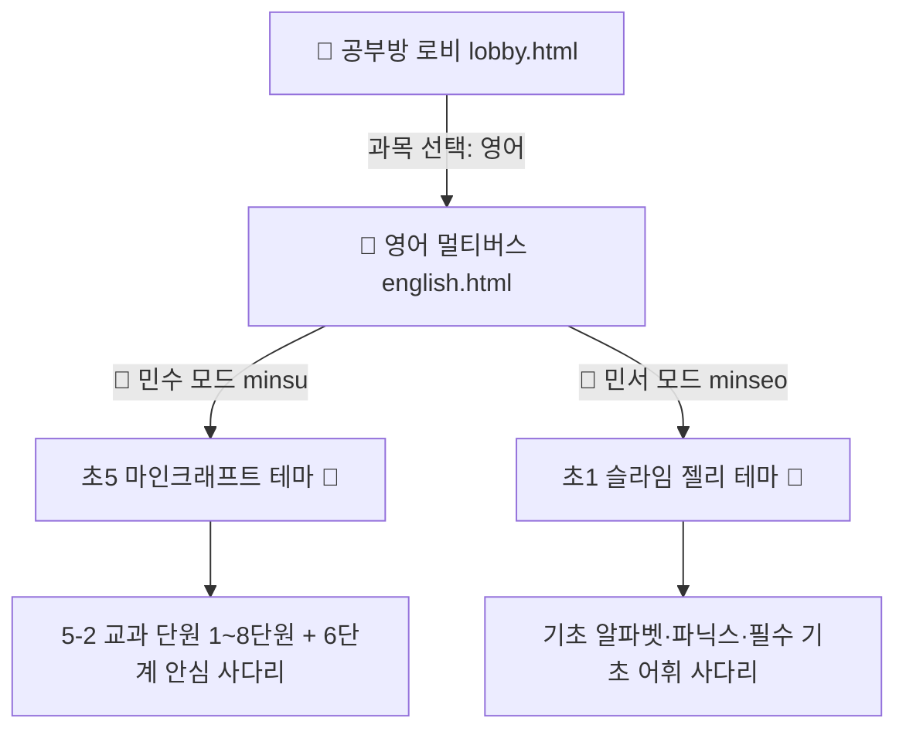
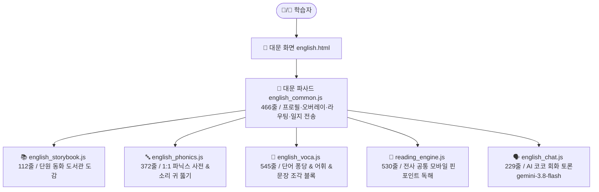
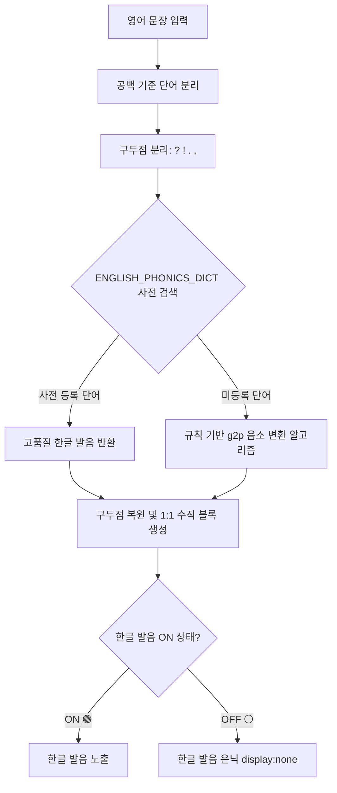
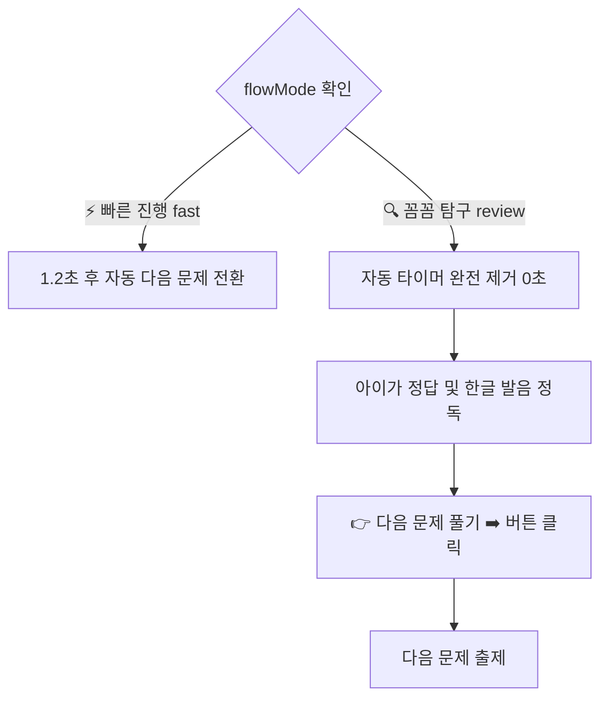

# 🏰 초등 영어 멀티버스 안심 사다리 및 파닉스·발화 템포 통합 명세서 (english_spec.md)

## 1. 개요 및 설계 철학 (Overview & Core Philosophy)
* **문서 목적**: 초등학교 영어 교육과정(초5 천재교육 함순애 교과서 기준 및 초1 기초 파닉스)을 민수의 인지 프로필(`docs/minsu_learning_profile.md`)과 결합하여, 타이핑 스트레스 없이 재미와 성취감으로 완주할 수 있는 **'초등 영어 멀티버스'**(`kids/subjects/english/english.html`)의 프론트엔드·오디오·파닉스·데이터베이스 통합 단일 원천(SSOT) 명세서.
* **핵심 설계 철학**:
  1. **실패 없는 학습 (Errorless Learning & Zero-Typing)**:
     - 철자 직접 타이핑으로 인한 좌절과 거부감을 100% 배제하고, **'3지선다 콕 터치'**와 **'단어 조각 블록 순서 맞추기'** 방식으로 인지 부하를 최소화한다.
     - 오답 선택 시 감점이나 붉은 X 대신 힌트 블록과 함께 재도전 기회를 제공하여 언제나 100% 성공으로 마무리한다.
  2. **파닉스 디딤돌 분리 원칙 (Scaffolding Separation)**:
     - 아직 파닉스 음소 인지가 완성되지 않은 민수를 위해 한글 발음을 지원하되, **출제 중에는 발음을 철저히 숨겨 영어 철자와 소리에 집중**하게 하고, **정답을 맞힌 순간에만 1:1 수직 정렬 블록으로 한글 발음을 노출**하여 성취감과 발음 확인을 동시에 달성한다.
  3. **청각 처리 지연 배려 및 수동 템포 제어권 (Tempo Mastery)**:
     - 일반 음성 속도를 따라가기 힘든 아이를 위해 **원어민 음성 4단계 속도 조절(0.5x 초저속 ~ 1.0x)**을 제공한다.
     - `🔍 꼼꼼 탐구` 모드에서는 자동 넘김 타이머를 일체 제거하고, 아이가 정답 문장을 눈으로 충분히 읽은 뒤 **`[👉 다음 문제 풀기 ➡️]`를 직접 누를 때만 넘어가도록** 완전한 주도권을 보장한다.

---

## 2. 자녀별 맞춤 이원화 프로필 (Dual Profile System)



| 구분 | 👦 민수 (초5) | 👧 민서 (초1) |
| :--- | :--- | :--- |
| **교과 기준** | 2015/2022 개정 초등 5학년 2학기 (천재교육 함순애) | 초등 1학년 기초 파닉스 & 생활 영어 어휘 |
| **실질 인지 수준** | **초등학교 3~4학년 수준 맞춤** (`minsu_learning_profile.md`) | 초등학교 1학년 눈높이 시각/청각 놀이 |
| **UI 테마 & 보상** | 마인크래프트 블록 테마 / 에메랄드·다이아 (`💎`) | 핑크/퍼플 슬라임 테마 / 하리보 젤리 (`🍬`) |
| **주요 학습 모드** | 단어 콕 터치, 문장 조각 블록 빌더, 1:1 한글 발음 디딤돌 | 알파벳 소릿값 매칭, 그림 카드 터치, 챈트 따라하기 |
| **음성 기본 속도** | **0.85x (기본 배속)** | 0.85x 또는 1.0x 표준 배속 |

---

## 2-1. 🏰 영어 멀티버스 골디락스 모듈화 아키텍처 (Goldilocks Modular Architecture)

전사 최고 거버넌스 헌법(규칙 7조: 골디락스 적정 응집도 300~600줄, 절대 상한 800줄 미만)에 의거하여, 기존 2,154줄의 비대했던 `english_common.js`를 **1개의 초경량 대문 파사드와 4개의 전문 서브모듈**로 완전 분리 구축하였습니다.



| 모듈 경로 | 역할 및 책임 | 라인 수 | 네임스페이스 |
| :--- | :--- | :---: | :--- |
| **`kids/js/english_common.js`** | 🏰 대문 파사드 (프로필 초기화, 오버레이 제어, 데이터 페칭, 학년/단원 필터링, 완료 학습일지 전송, 4선지 인쇄실) | 466줄 | `window.EnglishCommon` |
| **`kids/js/english_storybook.js`** | 📚 [1단계] 스토리북 서가 도감 모듈 (단원별 동화 목록, 모달 렌더링, e-Book/웹툰 뷰어 연동) | 112줄 | `window.EnglishStorybook` |
| **`kids/js/english_phonics.js`** | 🔤 [1단계 알파벳 & 3단계 파닉스] 발음 디딤돌 엔진 (1:1 파닉스 사전, Jenny Neural TTS 음성, [1단계] 알파벳 터치방, [3단계] 소리 귀 뚫기) | 372줄 | `window.EnglishPhonics` |
| **`kids/js/english_voca.js`** | 🧩 [2·3·4단계] 어휘·문장 훈련소 ([2단계] 3지선다 퐁당, [3단계] 4종 어휘/슬라임 자석, [4단계] 문장 블록 빌더 & 성공 카드) | 545줄 | `window.EnglishVoca` |
| **`kids/js/english_chat.js`** | 🗣️ [6단계] AI 코코 회화 토론 모듈 (지문별 롤플레잉, 생각 확장 대화, 2026 플래그십 `gemini-3.8-flash` 적용, 부모 검수 뱃지) | 229줄 | `window.EnglishChat` |
| **`kids/js/english_unit_bar.js`** | 📚 대기실 단원 칩 바 & 「이번 단원 특별 활동」 칸 (아래 2-2) | 약 200줄 | `window.EnglishUnitBar` |
| **`kids/js/english_listen_place.js`** | 🎧 [특별 활동 공통 엔진] 듣고 끌어다 놓기 (Listen & Place) 엔진 (단원 확장형, 에러리스 피드백, 누르기·끌기 지원, VOCA DB 실시간 연동) | 약 500줄 | `window.EnglishListenPlace` |
| **`kids/js/english_listen_place_dressup.js`** | 👗 [8단원 장면] 친구 옷 입히기 장면 모듈 (인물·의류·헤어·눈 SVG 렌더링, 마지막 판 친구 찾기) | 약 420줄 | `EnglishListenPlace.registerScene('dressup', …)` |
| **`kids/js/english_listen_place_timeline.js`** | 🕖 [10단원 장면] 하루 시간표 채우기 장면 모듈 (활동 그림·아날로그 시계 SVG 렌더링, 마지막 판 얼리버드/나이트아울 미니 시간표) | 약 360줄 | `EnglishListenPlace.registerScene('timeline', …)` |
| **`kids/js/english_listen_place_map.js`** | 🧭 [11단원 장면] 마을 길 찾기 장면 모듈 (마을 지도·장소 그림·위치 표지 SVG 렌더링, 완료 시 경로 화살표, 마지막 판 지도 3장) | 약 370줄 | `EnglishListenPlace.registerScene('map', …)` |

## 2-2. 📚 단원 칩 바와 단원별 특별 활동 (2026-11-06 결정)

- **뼈대는 활동 순서(6단계 사다리)**: 영어는 단원이 바뀌어도 하는 활동(파닉스·단어·문장 조립·독해·회화)이 같고, 담임 선생님이 단원마다 주시는 **클래스 카드 단어·문장**만 바뀐다. 그래서 과학방처럼 단원별 구역으로 쪼개지 않는다. 클래스 카드 → 노션 VOCA_DB → 모든 단계 자동 출제 흐름을 그대로 쓴다.
- **단원 칩**: 대기실 머리 카드 아래에서 학기(5-1·5-2 등)·단원을 먼저 고르면 2~4단계가 선택 화면 없이 그 단원으로 바로 시작한다. 「전체」나 「단계마다 고르기」는 예전처럼 단계마다 고른다. 목록은 VOCA_DB 원문에서 만든다.
- **이번 단원 특별 활동**: 그 단원에만 맞는 활동이 있을 때만 단원 칩 아래에 칸이 생긴다. 등록은 `kids/subjects/english/data/english_unit_activities.js`에 한 줄. 등록 기준:
  1. 그 단원 클래스 카드의 핵심 문장을 그대로 연습한다 (수행평가와 바로 연결).
  2. 데이터만 바꿔 두 단원 이상에 쓸 수 있는 엔진이다. 단원 하나만을 위한 일회성 게임은 만들지 않는다.
- **첫 특별 활동 (구현 완료)**: 「듣고 끌어다 놓기(Listen & Place)」 엔진 (`kids/js/english_listen_place.js`).
  - **8단원 옷 입히기**: `kids/subjects/english/listen_place.html?grade=5-2&unit=L8` (장면 `dressup`, `kids/js/english_listen_place_dressup.js`, 데이터 `kids/subjects/english/data/listen_place_5-2_L8.js`).
  - **10단원 하루 시간표 채우기**: `kids/subjects/english/listen_place.html?grade=5-2&unit=L10` (장면 `timeline`, `kids/js/english_listen_place_timeline.js`, 데이터 `kids/subjects/english/data/listen_place_5-2_L10.js`).
  - **11단원 마을 길 찾기**: `kids/subjects/english/listen_place.html?grade=5-2&unit=L11` (장면 `map`, `kids/js/english_listen_place_map.js`, 데이터 `kids/subjects/english/data/listen_place_5-2_L11.js`).
  - **입력**: 폰 폭 375px 무스크롤, 터치/마우스 끌어다 놓기와 누르기(탭) 둘 다 지원.
  - **피드백**: 에러리스 (하트·점수 차감 없음, 틀리면 정답 카드 노란 펄스 안내 및 문장 재재생).
  - **마지막 판 피날레**: 「Catch the Impostor (친구를 찾아라!)」를 흡수하여 3명의 후보 중 문장과 일치하는 친구를 선택.
  - **확장성**: 9단원 방에 가구 놓기(`room`), 11단원 지도에서 길 찾기(`map`)로 장면만 갈아 끼워 확장 가능.
  - 명세: [`docs/english_listen_place_spec.md`](english_listen_place_spec.md), [`docs/english_listen_place_L10_spec.md`](english_listen_place_L10_spec.md), [`docs/english_listen_place_L11_spec.md`](english_listen_place_L11_spec.md).

## 2-3. 🃏 클래스카드 연습 (2026-11-22, 카드 노션 이관 2026-11-28)

담임 클래스카드 앱은 **1단계 매칭(2×4 짝맞추기)에서 1,500점을 넘어야 2단계 테스트(카드 넘기기)** 이 열리는데, 시간제한 때문에 아이가 힘들어한다. 같은 구조를 공부방에 두고 시간제한만 고를 수 있게 해서 익숙해지게 한다. 원형은 사용자가 제미나이와 만든 프로토타입(단일 HTML 3,000줄)이고, 공부방 규칙에 맞게 다시 짰다.

- **주소**: `kids/subjects/english/classcard.html?grade=5-2&unit=L11`. 영어방 단원 칩에서 5-2 · 11단원을 고르면 「이번 단원 특별 활동」에 🃏 카드가 뜬다. 등록표(`english_unit_activities.js`)에는 적지 않고, `english_unit_bar.js`가 `EnglishClasscard.Deck.listUnits()`로 노션 「클래스카드 DB」에 지금 아이가 쓸 「사용」 카드로 묶음을 만들 수 있는 단원(연습 화면 `buildDeck`과 같은 기준: 뜻·구간이 있는 카드 4장 이상)을 받아 띄운다(엣지 캐시 5분, 통신이 안 되면 기기에 기억한 목록 `classcard_units_v1_{son|daughter}`, 2026-11-28 사용자 선택 「노션 보고 자동 표시」).
- **카드 묶음 = 노션 「클래스카드 DB」 (2026-11-28~)**: 칸은 영어·뜻·읽기·학년·단원·학생·구간·순번·카드번호·사용(`docs/notion_schemas_school.md` 「클래스카드 DB」, `APP_CONFIG.CLASSCARD_DB_ID`). 화면은 `kids/js/english_classcard_deck.js`(`EnglishClasscard.Deck.load`)가 열 때마다 노션을 `?force=true`로 새로 읽어 **「사용」이 켜진 카드만** 엔진 계약 `{id: 카드번호, section: 구간, en: 영어, ko: 뜻, say: 읽기}`으로 넘긴다. 구간 안 순서는 순번, 사용 카드가 없는 구간은 로비에서 숨긴다. 학생 칸은 지금 아이 또는 「공통」 카드만 보인다(민서가 영어방 「5학년 미리보기」를 켰으면 민수 카드도). 그래서 민서로 5-2 L11을 열면 「준비 중」이다(2026-11-28 승인). 노션 통신이 안 되면 아이·단원별로 기기에 기억한 마지막 묶음(`classcard_deck_v1_{son|daughter}_{학년}_{단원}`, 민서 5학년 미리보기를 켠 상태는 `daughter_preview`로 따로)으로 열고 로비에 「기억한 카드로 열었어요」를 붙인다. 노션에 사용 카드가 4장보다 적으면 기억을 지우고 「준비 중」. **카드번호는 별표·문항기록 키(`s:cc-<학년>-<단원>:<번호>`)라 바꾸지 않는다**. 부모가 카드를 끄면 그 카드의 별표는 `state.hiddenBookmarks`로 남겨 다시 켜면 돌아온다. 예전 정적 파일 `data/classcard_5-2_L11.js`는 지웠고 같은 카드번호로 옮겼다(민수 별표·기록 유지).
- **클래스카드 글자 그대로**: VOCA_DB 단원 어휘(교과·클래스카드 뜻 병기, 11단원 60행)를 쓰지 않는다. 아이가 실제 시험에서 보는 단어·뜻만 보여 줘야 덜 헷갈린다(2026-11-22 사용자 결정). 뜻도 고치지 않는다: `go straight` = 「성실히 살다, 갱생하다」, `turn left` = 「왼편을 향하다」(선생님이 고치기 전까지). `{2}`·`/`·`~` 같은 클래스카드 표기는 화면에 그대로 두고, 읽을 글자만 「읽기」 칸(`say`)에 따로 적는다(자연어를 잘라 해석하지 않음).
- **흐름**: 로비(구간·시간제한·안심 모드·영어 속도) → 1단계 매칭 → 1,500점 안내창 → 2단계 테스트 10장 → 결과(다시 볼 카드·별표 카드).
- **1단계 매칭** (`kids/js/english_classcard_grid.js`, `EnglishClasscard.Grid`): 왼쪽 영어 4칸·오른쪽 뜻 4칸. 맞힌 두 칸만 바뀐다. **실제 클래스카드처럼 판 위에 맞는 짝은 보통 1쌍, 가끔 2쌍(20%)** 이고 나머지 카드는 짝이 없다(2026-11-23 사용자 확인). 0쌍 판은 없고, 짝 없이 4번 넘게 남은 카드는 다음 채우기 때 짝을 넣어 준다(재 보면 한 카드가 짝 없이 보통 7~9번 안에 짝을 만난다). 카드가 7장보다 적은 작은 구간은 짝이 더 생길 수 있다. 판 계산 `Grid.logic`은 DOM 없이 시험. 점수 50 · 2연속 80 · 4연속 100 · 소리 카드 100. **영어 발음은 맞혔을 때만** 나온다(카드를 누르거나 틀렸을 때는 읽지 않음, 실전 모드 소리 카드만 눌러서 듣기).
- **시간제한**: 없음(기본) · 천천히 3분 30초 · 기본 2분. 안심 모드에서는 마지막 30초에 색만 바뀌고 「Hurry UP」은 나오지 않는다.
- **안심 모드(기본 켬)**: 틀려도 감점·잠금 없이 흔들림 + 「영어 = 뜻」 안내(글자만). 끄면 실제 앱처럼 -50점·3초 잠금·소리 카드(15%)·테스트의 빨간 X.
- **2단계 테스트** (`kids/js/english_classcard_cards.js`, `EnglishClasscard.Cards`): 앞면 문제 → 왼쪽으로 밀기(또는 아래 띠 누르기) → 뒷면 6지선다·철자. 유형은 뜻→영어 / 소리→뜻 / 뜻→철자 차례. 보기는 문제를 열 때 `QuizChoices.arrange`로 섞는다. 뒷면 위에 문제 뜻을 작게 다시 보여 준다.
- **철자 타이핑 (2026-11-23)**: 로비 「✍️ 2단계 철자 연습」에서 두 가지를 고른다(아이·단원별 저장).
  - **타이핑 비중**: 블럭 전체(기본, 🧩 글자 블럭) · 마무리 타이핑(철자 자리 중 마지막 1~2문항만 ⌨️ 타이핑) · 전체 타이핑. 블럭은 기호 없는 세 낱말 이하 카드만, 타이핑은 기호가 든 문장도 낸다. 자리에 맞지 않는 카드는 객관식 자리 카드와 바꾸고, 없으면 6지선다. 카드 위 블럭↔입력 전환 단추는 없앴다(비중은 로비에서).
  - **자판 위치 안내**: 항상 켜기(다음 키 계속 표시) · 막히면 반짝이기(기본: 오타를 누르거나 3초 멈추면 정답 키만 반짝) · 끄기. 💡 힌트 키는 언제나 다음 키를 1.6초 반짝이고 문항기록에 힌트로 남는다.
  - **폰 자판** (`kids/js/english_qwerty.js` + `kids/css/english_qwerty.css`, `window.EnglishQwerty`): 실제 폰 영문 자판 10-9-7 배열 + ⌫, 아랫줄 `'` · Space · 💡 힌트, 소문자 고정. 키 높이 46px(359px 이하 44px)·간격 3px, 타이핑 카드에서는 자판을 카드 여백까지 넓힌다(360px에서 키 폭 약 28px). `<input>`을 쓰지 않아 폰 OS 키보드·자동완성이 뜨지 않고, PC 물리 키보드도 같은 처리로 받는다.
  - **채점**: 대소문자 구분 없이 소문자로 치면 되고, 칸에는 원래 글자를 보인다. 알파벳·Space·`'`만 친다. `{…}`(안 내용 포함)·`/`·`~`·`.`·`?`는 회색으로 미리 채우고 건너뛴다(규칙은 모듈 맨 위 `AUTO_SKIP_REGEX` 한 줄). 끝쪽 띄어쓰기와 `{2}` 뒤 띄어쓰기도 건너뛴다(`go straight {2} blocks` → 공백 한 번).
  - **에러리스**: 틀린 키는 칸에 들어가지 않고 지금 칸만 노란 밑줄로 흔들린다(빨간 X·감점 없음, 안심 모드를 꺼도 같음). 첫 오타는 `fairyEncourage`, 그다음은 짧은 효과음. 문항기록에는 처음 세 번의 오타 키만 남기고, 오타가 있었으면 「한 번에 정답」에서 빠진다.
- **잠금**: 1,500점을 한 번 넘으면 그 단원 2단계는 계속 열린다(실제 앱과 같음). 부모 로그인(아빠·엄마·어른)에서만 「2단계 미리보기 열기」·「기록 지우기」가 보인다. 기록은 아이·단원마다 기기에 `classcard_v1_{son|daughter}_{학년}_{단원}`.
- **소리**: 영어는 `speakEnglish`(영어방 속도 설정 0.75·0.85·1.0을 함께 씀). 매칭(짝맞추기)은 빨리 이어지므로 짧은 효과음 + 발음만, 테스트는 정답 `fairyPraise` · 오답 `fairyEncourage` · 완주 `fairyReward`(보상 세션). 1,500점 통과 때 `fairyReward('quest')`.
- **보상·기록**: 1,500점 첫 통과는 하루 한 번 💎3 + 학습일지(`claimMissionRewardOnce`). 테스트는 공통 퀴즈 보상 세션(2문제마다 1개, 완주 +5, 학습일지 한 번, 중간에 나가도 일지). 문항기록 키는 `s:cc-<학년>-<단원>:<카드 id>`(정적 자료 접두어, `docs/learning_record_spec.md` §5).
- **새 단원·카드 추가 (공식 도구)**: 담임 클래스카드를 보고 `scripts/data/classcard/english_<학년>_<단원>.json`(형식은 도구 맨 위 설명, 예 `english_5-2_L11.json`)을 만들고
  `python -X utf8 scripts/register_classcard.py --file scripts/data/classcard/english_5-2_L12.json` → 미리보기 확인 → `--apply`(없는 행만). 코드·등록표는 고치지 않는다(노션 행만 있으면 영어방 칸과 연습 화면이 생긴다). 노션에 직접 행을 넣어도 된다(학년·단원 선택지, 카드번호는 그 단원 안에서 하나만).
  - 같은 행 = 학년·단원·카드번호. `--apply`는 기존 행을 덮지 않고 바뀔 칸만 보여 준다(폰 노션에서 고친 글자 보존). `--update`는 글자·구간·순번도 자료대로 덮는다.
  - 「사용」은 행을 처음 만들 때만 자료 값(`use`, 기본 켬)으로 쓰고 그 뒤로는 덮지 않는다. 부모가 폰 노션에서 켜고 끈다. 도구로는 `--set-use on --cards 35-44`(적은 카드만).
  - 노션에만 있는 행은 알려 주기만 하고 지우지 않는다.
- **11단원 4구간 (2026-11-28)**: 담임 선생님이 알려 준 문장 10개(35~44번, `Where is the restaurant?` … `It is next to the rocks.`)를 4구간으로 넣었다(사용자 선택: 4구간 하나). 선생님 클래스카드에 아직 안 올라와서 **사용 끔**으로 등록했다. 올라오면 폰 노션에서 「사용」을 체크하거나 `register_classcard.py --file scripts/data/classcard/english_5-2_L11.json --set-use on --cards 35-44`.
- **시험**: `scripts/test_register_classcard.py`(가짜 통신: 미리보기는 안 씀·새 행만·사용 칸은 처음만·`--set-use`·노션에만 있는 행·자료 L11 44장), `tests/english-unit-bar.test.mjs`(🃏 칸은 노션 단원 목록에 있을 때만), `tests/english-classcard.test.mjs` (등록 자료 → 노션 행 모양 → 실제 `Deck.buildDeck`(`tests/classcard-seed.mjs`)으로 만든 묶음: 사용 끈 카드·빈 구간 숨김·아이별 거르기·순번·`load`의 `?force=true`/기기 기억/준비 중·`listUnits`·끈 카드 별표 보존, 카드 묶음 글자·판 짝 1~2쌍과 오래 남은 카드 무작위 1만 회·작은 구간·맞혔을 때만 발음·점수·문제 만들기·철자 조각·음성/보기 섞기 규칙·싣는 순서), `tests/english-qwerty.test.mjs` (글자 칸 건너뜀·띄어쓰기 다듬기, 가짜 DOM으로 입력기 오타·완료 한 번·지우기·물리 키보드·위치 안내 3종·정리, 타이핑 비중 자리 계산).

---

## 3. 6단계 안심 사다리 학습 파이프라인 (6-Stage Learning Ladder)


### 1) 1단계 [원서 친숙해지기] 📚 단원 동화 도서관 (`openStoryBook` / `EnglishStorybook`)
- **서가 구축 목록 (단원별 E-Book/웹툰 하이브리드 도서관)**:
  - 🏠 **9단원 (L9)**: `Welcome to My Dream House!` (어서 와, 나의 꿈의 집으로! · 집과 방의 물건 소개하기)
  - 🔍 **8단원 (L8)**: `The Great Festival Mission` (위대한 축제 미션 · 외모와 옷차림 묻고 답하기)
  - ⛺ **7단원 (L7)**: `Minsu and Junwoo's Weekend` (민수와 준우의 즐거운 주말 · 지난 일 묻고 답하기)
  - 🧭 **11단원 (L11)**: `Minsu Explores the Village` (민수의 신나는 마을 탐험 · 위치 묻고 길 안내하기)
- **교재 8~10컷 일러스트 스토리북**: 교과서 본문 대화와 핵심 어휘를 담은 고화질 삽화와 함께 감상.
- **E-Book 모드**: 책장 넘김 효과, 영문/한글 해석 펼침면 전환, 페이지별 오디오 1:1 싱크.
- **웹툰 모드**: 위아래 스크롤 뷰, 컷별 `[🇺🇸 영어 듣기]` / `[🇰🇷 한국어]` 독립 오디오 버튼 제공.
- **오디오 싱크 가드**: 1장 표지 삽화 로드 시 음성이 중복(2번) 재생되지 않도록 표지/본문 인덱스 오프셋 엄수.

### 2) 2단계 [귀 뚫기 디딤돌] 🔤 파닉스 훈련소 (`EnglishPhonics`)
- **음가 학습 & 슬라임 알파벳 자석판**: 알파벳 음가 훈련, 소리 듣고 3지선다 콕 터치.
- **출제 시 발음 은닉**: 문제 풀이 단계에서는 한글 발음을 감추고 소리와 철자 연결에 집중.

### 3) 3단계 [어휘 빌드업] 💡 영단어 핵심 정복 (`EnglishVoca`)
- **4종 모드**: 보고 따라 적기(`copy`), 한글 ➔ 영어(`toEnglish`), 영어 ➔ 한글(`toKorean`), 듣고 적기(`listening`).
- **슬라임 철자 자석판 셔플**: 초성 힌트와 슬라임 자석판을 통한 에러리스 자기주도 어휘 정복.

### 4) 4단계 [실전 딥 다이브] 🧩 문장 조각 맞추기 (`renderSentenceQuizUI`)
- **단어 조각 배열 & 빈칸 완성**: 문장 구조(주어+동사+목적어 등)를 조각 블록 터치로 순서대로 완성.
- **정답 성공 카드 (`renderStage4SuccessCard`)**:
  - 문장 조각을 맞추는 순간 축하 이펙트와 함께 정답 성공 카드 노출.
  - **영단어 하단 1:1 수직 정렬 블록**으로 한글 발음 노출 (`renderSentencePhonicsHtml`).
  - 정답 카드 상단에 **`[🗣️ 한글 발음 ON 🟢 / OFF ⚪]` 토글 버튼** 상시 배치.
- **다음 문제로 넘기기 (2026-11-16 수정)**: 성공 카드의 「다음 문제 풀기」(꼼꼼 탐구)와 1.8초 자동 넘김(빠른 진행)은 `window.activeQuizIdx`를 올려 다음 문장으로 간다. `english_common.js`가 이 window 경로를 자기 `let` 번호와 이어 두어야 하며, 이음이 빠지면 첫 문장만 되풀이된다(5-2 L10 제보). 시험 `tests/english-stage4-advance.test.mjs`.

### 5) 5단계 [문맥 문해력] 📖 정밀 독해 트레이닝 (`kids/core/reading_engine.js`)
- **목록 (2026-11-16)**: 학기 탭 없이 트랙 → 학기(5-2, 5-1) 묶음을 접고 펴는 한 줄 목록(공통 `GroupedList`). 줄을 누르면 요약과 [도전하기]가 펼쳐진다. 국어방과 같은 부품.
- **로비 단원 칩 연동 (2026-11-16 결정)**: 칩에서 학기·단원을 골라 두면 독해·토론 목록 맨 위에 「⭐ 고른 단원」 묶음을 펴고 강조한다. 노션 「회차/단원」이 칩 표시 이름(`L7` → `7단원`)과 글자까지 같은 지문만 모은다. 그 단원 지문이 없으면 "준비 중이에요" 안내만 띄우고 다른 묶음은 그대로 둔다. **거르지 않는 이유**: 단원당 지문이 1~2편뿐이고 2학기 지문이 아직 다 없어서, 거르면 빈 화면이 되기 쉽다(Argon 검토 같은 의견).
- **정답 적기 (2026-11-16)**: 문제데이터의 `answer`는 보기 글자를 그대로 적는다. 채점은 `ReadingEngine.resolveAnswerIndex`가 보기 글자 일치를 먼저 본다(전에는 「3시 30분」의 맨 앞 3을 3번 보기로 읽어 9단원 1번·10단원 2번이 틀리게 채점됐다).
- **지문 원천**: 노션 독해 DB(`LIBRARY_DB`, 과목 `영어`)만. `kids/data/english-reading-data.js`는 노션이 비거나 끊길 때 예비. 2026-11-16 기준 5-1 1~6단원 8편 + 5-2 7~11단원 5편(순번 10~14). 5-2 지문은 모두 그 단원 노션 어휘(단어·문장)와 스토리북을 참고해 새로 쓴 이야기다. 7·8·11단원은 9월에 그렇게 만들어 로컬 파일에만 있던 것을 옮겼고(자료 `scripts/data/reading/english_5-2_l7_l8_l11.json`, 문항 초안 agy Hydrogen), 9·10단원은 같은 방식으로 새로 썼다(`english_5-2_l9_l10.json`, 지문·문항 초안 agy Hydrogen, 검토 Claude). **새 단원 지문 만들기**: 그 단원 VOCA_DB 단어·문장 + 스토리북 장면 → 90~130단어 4문단 + 우리말 4지선다 4문항(세부 2·핵심 표현 1·주제/마음 1) → 관제탑 `register_reading_passage.py --file … --dry-run` 후 등록.
- **모바일 핀포인트 독해**: 스크롤 피로 없는 1문항 슬라이스 카드 + 💡 [결정적 단서] 접이식 단락 힌트 토글 + 📜 지문 전문 바텀시트.

### 6) 6단계 [실전 응용 & 심화] 🗣️ AI 요정 회화 토론 (`EnglishChat`)
- **지문 목록 (2026-11-16)**: 정밀 독해와 같은 노션 지문을 같은 묶음 목록으로(`ReadingEngine.loadPassages('영어')`·`buildPassageGroups`). 전에는 로컬 파일을 먼저 보여 줘서 노션에 없는 7·8·11단원과 초반 예시 「The Lion and the Mouse」가 토론방에만 있었고, 9·10단원은 스토리북(10/08, 11/04)을 만들 때 지문을 만들지 않아 없었다. 예시 지문은 로컬 파일에서 지웠고 노션 행은 `register_reading_passage.py --archive eng_read_01 --apply`로 휴지통에 보냈다(원본 `scripts/data/archive/library_eng_read_01_20261116.json`). 독해를 끝내면 「이 지문으로 코코와 토론하기」로 바로 이어진다.
- **2026 플래그십 표준**: `gemini-3.8-flash` 기반 상황별 롤플레잉 및 지문 심층 토론.
- **생각 확장 코칭**: 요정 코코와 배운 표현을 응용하여 자유롭게 대화하고 부모 검수 뱃지 획득.
- **대화 기록 (2026-11-16 되살림)**: 토론 창을 닫으면(또는 페이지를 떠나면) 노션 「AI 대화 기억 보관소」에 1줄 남는다. 과목 `영어`, 단원 칸에 지문 「회차/단원 · 제목」, 요약에 아이가 물어본 영어 표현. 같은 화면 🧚 코코 창에 물어본 것도 창을 닫을 때 따로 1줄. 9월 초~11-16에는 저장 모듈 연결이 끊겨 기록이 없다. 규칙은 `CORE_CATALOG.md` 「`chat-memory.js`」.
- **코코 답변 읽기 (2026-11-16)**: 한영이 섞인 답변(「'I love my friends!'라고 해요」)은 한글은 선희, 영어는 영어 목소리로 나눠 읽는다. 전에는 글 전체를 한 목소리로 읽어서 영어가 많으면 영어 목소리가 한글까지, 아니면 선희가 영어까지 읽었다. 영어방 🧚 코코 창도 같다. 규칙은 `CORE_CATALOG.md` `speakFairyTTS`.

### 🖨️ 특별 지원: 학습지 인쇄실
- **4선지 줄공책 인쇄실 (`print_notebook.html`)**: 초등 4선지 규격에 맞춘 알파벳/단어 쓰기 연습지.
- **단원 보카 미니북 인쇄실 (`print_minibook.html`)**: 단원별 핵심 단어/문장을 손바닥 크기 미니북으로 인쇄.

---

## 4. 파닉스 한글 발음 디딤돌 아키텍처 (Phonics Scaffolding Engine)



### 1) 1:1 수직 정렬 렌더링 규격 (`renderSentencePhonicsHtml`)
```html
<div class="phonics-sentence-box">
  <div class="phonics-word-unit">
    <span class="p-eng">What</span>
    <span class="p-kor">왓</span>
  </div>
  <div class="phonics-word-unit">
    <span class="p-eng">did</span>
    <span class="p-kor">디드</span>
  </div>
  <div class="phonics-word-unit">
    <span class="p-eng">you</span>
    <span class="p-kor">유</span>
  </div>
  <div class="phonics-word-unit">
    <span class="p-eng">do?</span>
    <span class="p-kor">두?</span>
  </div>
</div>
```

### 2) CSS 스타일 가이드
- `.phonics-sentence-box`: `display: flex; flex-wrap: wrap; gap: 8px 12px; justify-content: center;`
- `.phonics-word-unit`: `display: inline-flex; flex-direction: column; align-items: center;`
- `.p-eng`: `font-size: 1.25rem; font-weight: 700; color: #1e293b;`
- `.p-kor`: `font-size: 0.85rem; font-weight: 600; color: #6366f1; background: #e0e7ff; padding: 1px 6px; border-radius: 4px; margin-top: 3px;`
- `.hide-phonics .p-kor`: `display: none !important;`

### 3) 사전(`ENGLISH_PHONICS_DICT`) 및 g2p 폴백 체계
- **내장 사전 (`ENGLISH_PHONICS_DICT`)**: 초등 5학년 1~8단원 핵심 단어 및 빈출 표현(의문사, 조동사, 과거동사 등 500개 이상) 100% 매핑.
  - 예: `what ➔ 왓`, `did ➔ 디드`, `last ➔ 라스트`, `weekend ➔ 위켄드`, `visited ➔ 비지티드`, `grandpa ➔ 그랜파`.
- **규칙 기반 g2p 알고리즘 (`transcribeEnglishToKoreanPhonics`)**:
  - 사전에 없는 신규 단어가 들어올 경우 자음/모음 음소 분해 규칙을 통해 자연스러운 한국어 표기 자동 합성.

### 4) 토글 상태 영구 보존 API
- `isEnglishPhonicsEnabled()`: `localStorage.getItem('english_phonics_visible') !== 'off'` (기본값 `true/ON`).
- `setEnglishPhonicsEnabled(enabled)`: 스토리지 저장 및 화면 내 모든 `.phonics-toggle-btn`, `.p-kor`, `.phonics-sentence-box` 실시간 갱신.
- `toggleEnglishPhonics()`: 상태 반전 및 UI 동기화.

---

## 5. 원어민 Edge-TTS 오디오 및 발화 속도 제어 파이프라인

### 1) 오디오 엔진 및 음성 표준
- **엔진**: Microsoft Edge Neural TTS (Cloudflare Worker `/api/tts` 스트리밍).
- **영어 보이스**: **`en-US-JennyNeural`** (자연스럽고 또렷한 미국식 여성 원어민 음성).
- **한국어 해설/요정 보이스**: **`ko-KR-SunHiNeural`** (`speakFairyTTS`).

### 2) 4단계 발화 속도 표준 (`localStorage('english_speech_rate')`)
```html
<div class="speech-speed-selector">
  <button class="speed-btn" onclick="setSpeechSpeed(0.5)">0.5x 초저속</button>
  <button class="speed-btn" onclick="setSpeechSpeed(0.7)">0.7x 저속</button>
  <button class="speed-btn active" onclick="setSpeechSpeed(0.85)">0.85x 기본</button>
  <button class="speed-btn" onclick="setSpeechSpeed(1.0)">1.0x 표준</button>
</div>
```
- **기본 속도**: **`0.85x`** (민수의 청각 인지 속도에 최적화된 안심 배속).
- **초저속 `0.5x`**: 발음이 뭉개지거나 빠른 복합단어(예: *basketball, visited*)를 낱낱이 분해해서 들을 때 사용.
- **오디오 재생 시 적용**: `audioEl.playbackRate = currentSpeed;`.

---

## 6. 전 과목 공통 템포 컨트롤러 (`quiz-flow-controller.js`) 연동



- **Local-First SWR 원칙**: 화면 진입 시 로컬 스토리지에서 0초 즉시 로드 후 백그라운드에서 노션 INVENTORY DB의 `학습설정` 속성과 동기화.
- **영어방 수동 제어 엄수**: `flowMode === 'review'`일 때 어떠한 `setTimeout` 자동 전환도 허용하지 않으며, 오직 사용자의 명시적인 버튼 클릭 이벤트로만 다음 단계로 전환한다.

---

## 7. 노션 VOCA DB 연동 규격 (Notion Database Specification)

* **데이터베이스 ID**: `375a27115b688038b686d3994ee12919` (VOCA DB)
* **주요 필드 매핑** (2026-11-08 노션 스키마 도감 `docs/notion_schemas_school.md` 기준으로 바로잡음):
  - `단어` (title): 영문 단어/숙어/문장 (예: *"What did you do last weekend?"*)
  - `뜻풀이` (rich_text): 한국어 뜻 (예: *"지난 주말에 뭐 했니?"*)
  - `상세설명` (rich_text): 쓰임 설명과 예문
  - `품사` (rich_text): 명사·동사·문장 등
  - `과목` (multi_select): `영어`
  - `학생` (multi_select): `민수` / `민서`
  - `학년` (multi_select): `5-2` / `1-2`
  - `단원` (rich_text): `L11`처럼 단원 키 원문 (단원 칩이 이 값으로 묶는다)
  - `어휘유형` (select): `단어` / `숙어` / `문장`
  - `시험범위` (checkbox): 3·3·3 마스터리 앞 스테이지 우선 배치
  - `숙련도`·`달성`: 5분 퀘스트 진도 칸. 등록 도구는 쓰지 않는다

### 단원 어휘 등록 절차 (2026-11-08부터)
1. 클래스 카드·교과서 어휘를 `scripts/data/voca/english_<학년>_L<단원>.json`에 적는다 (형식: `CORE_CATALOG.md` 「과목 공용 어휘 등록기」, 예: `english_5-2_L11.json`).
2. `python -X utf8 scripts/register_voca.py --file scripts/data/voca/english_5-2_L12.json`으로 미리보기 → 신규·바뀔 칸·선택지 경고를 확인한다.
3. 이상 없으면 `--apply`로 새 행을 만든다. 담임 클래스 카드가 나와 글자를 바꿀 때는 노션에서 직접 고친다. 자료 JSON을 고쳐 덮어써야 할 때만 `--update`를 쓴다.
4. 단원마다 `insert_eng_l*_voca.py` 같은 스크립트를 새로 만들지 않는다 (`scripts/` 허용 목록이 커밋을 막는다).

### 7단원(What Did You Do Yesterday?) 핵심 문장 17선 SSOT:
1. `What did you do last summer?` (지난여름에 뭐 했니?)
2. `What did you do last weekend?` (지난 주말에 뭐 했니?)
3. `What did you do yesterday?` (어제 뭐 했니?)
4. `What did you do there?` (거기서 뭐 했니?)
5. `I ate chicken.` (치킨을 먹었어.)
6. `I made a car.` (자동차를 만들었어.)
7. `I played basketball.` (농구를 했어.)
8. `I took many pictures.` (사진을 많이 찍었어.)
9. `I visited my grandpa.` (할아버지를 방문했어.)
10. `I watched a movie.` (영화를 봤어.)
11. `I saw him.` (그를 봤어.)
12. `I cleaned my room.` (내 방을 청소했어.)
13. `I went camping.` (캠핑을 갔어.)
14. `How was it?` (어땠니?)
15. `It was fun.` (재미있었어.)
16. `It was hard.` (힘들었어.)
17. `It was boring.` (지루했어.)

### 8단원(He Has Short Curly Hair) 핵심 어휘 25선 & 문장 10선 SSOT:
* **단원 제재**: 외모와 옷차림 묻고 답하기 / 친구를 찾아라! (Find Your Friend!)
* **1구간 (헤어스타일 & 색상)**: `curly hair`, `straight hair`, `short hair`, `long hair`, `blonde hair`, `brown`, `blue`, `green`, `black`, `hazel`
* **2구간 (신체 & 의류 & 동사)**: `eyes`, `glasses`, `pants`, `shirt`, `dress`, `he`, `she`, `find`, `cry`, `wear`
* **3구간 (기타 어휘)**: `wrong`, `girl`, `boy`, `ask`, `any`
* **핵심 문장 10선**:
  1. `What does he look like?` (그는 어떻게 생겼나요?)
  2. `She has long straight hair and blue eyes.` (그녀는 긴 생머리와 파란 눈을 가지고 있어요.)
  3. `He has short curly hair and green eyes.` (그는 짧은 곱슬머리와 초록색 눈을 가지고 있어요.)
  4. `What is she wearing?` (그녀는 무엇을 입고 있나요?)
  5. `He is wearing blue pants.` (그는 파란 바지를 입고 있어요.)
  6. `She is wearing a red skirt.` (그녀는 빨간 치마를 입고 있어요.)
  7. `I don't know her.` (저는 그녀를 모릅니다.)
  8. `This is my friend, Sam.` (이 사람은 제 친구, 샘입니다.)
  9. `He looks cool!` (그는 멋져 보여요!)
  10. `Find your friend!` (친구를 찾아라!)
* **Phonics Fun (ow 소리)**: `show` [쇼], `snow` [스노], `yellow` [옐로]

### 9단원(What a Nice House!) 핵심 문장 10선 (1구간) SSOT:
* **단원 제재**: 집의 구조와 방 소개, 사물의 위치 및 존재 묻고 답하기 (미래엔 강정진 2022 개정)
* **핵심 문법/구문**: `What a + 형용사 + 명사!`, `This is the + 방 이름`, `There is / There are ~`, `Where is the ~?`
* **1구간 핵심 문장 10선**:
  1. `What a nice living room!` (거실이 정말 좋네요!)
  2. `What a nice house!` (정말 멋진 집이네요!)
  3. `This is the bathroom.` (여기는 욕실입니다.)
  4. `This is the bedroom.` (여기는 침실입니다.)
  5. `What's in the garden?` (정원에는 무엇이 있나요?)
  6. `There is a toilet in the bathroom.` (욕실에 변기가 있습니다.)
  7. `There are 4 chairs in the kitchen.` (주방에 의자가 4개 있습니다.)
  8. `Where is the bathroom?` (화장실은 어디예요?)
  9. `This is my dream house.` (이곳은 제 꿈의 집입니다.)
  10. `There are trees in the garden.` (정원에 나무가 있습니다.)

### 11단원(Where Is the Library?) 핵심 어휘 & 길 찾기 표현 SSOT:
* **단원 제재**: 위치 묻고 길 안내하기 (Minsu Explores the Village)
* **노션 등록**:
  - 2026-11-07 교과서 기준 47행 등록 (`VOCA_DB` 5-2 · `L11` = 단어 24 · 숙어 9 · 문장 14, 행 삭제 금지 원칙)
  - 2026-11-18 담임 클래스 카드 단어 반영 (`scripts/data/voca/english_5-2_L11.json` + `scripts/register_voca.py --update`): 60행 = 단어 34 · 숙어 11 · 문장 15
  - 2026-11-23 하이클래스 「영어 11단원 단어와 문장」 안내표 반영: **73행 = 단어 40 · 숙어 12 · 문장 21** (누락 단어 `shop, gold, box, rock, bird, house` · 숙어 `No problem` · 문장 6종 추가 및 뜻 7종 병기)
* **핵심 문장**: `Where is the ...?`, `Where is the restaurant/hospital/bank/library/flower shop/park?`, `Go straight two blocks and turn left/right.`, `Go straight one block and turn left/right.`, `Go straight and turn right at the big tree.`, `It's/It is next to the hospital/flower shop/rocks.`, `It's/It is on your left/right.`, `Thanks a lot.` / `No problem.`
* **핵심 어휘**: 장소(restaurant, bank, hospital, library, flower shop, park, school, candy shop, ice cream shop, museum, market, bookstore, post office, police station, bus stop, subway station, place, shop, house), 방향·위치(left, right, straight, corner, behind, block, turn, next), 층·순서(floor, first, second, third), 기타(map, town, tonight, eight, festival, gold, box, rock, bird), 숙어(go straight, turn left/right, next to, in front of, between A and B, on your left/right, one block, two blocks, on the corner, No problem)
* **듣고 끌어다 놓기**: `docs/english_listen_place_L11_spec.md` · 장면 `map` (2026-11-07 병합)

---

## 8. 보상 및 시간표 부스트 규칙 (Rewards & Timetable Boost)
1. **문제 풀이 실시간 보상**: 정답 2문제마다 실시간 +1💎/🍬 즉시 지급.
2. **10문제 완주 보너스**: 10문제 전량 완주 시 +5💎/🍬 (예습 부스트 시 +7💎/🍬).
3. **시간표 부스트 연동 (`timetable-boost.js`)**:
   - **오늘 복습 과목**: 일일 보상 획득 상한 100개 ➔ **150개 확장**, 경험치 **1.2배** 가산.
   - **내일 예습 과목**: 10문제 완주 보너스 기본 +5 ➔ **+7개** 지급.
4. **학습일지 자동 기록**: 1세션 완료 시 노션 학습일지 DB(`37aa2711...`)에 정답률, 문제 수, 소요 시간을 안전 전송 (`isLogged` 락 및 `pagehide` 이탈 가드 적용).
5. **영어 문장 오답노트 수집 체계 (`recordEnglishWrongAnswer`)**:
   - 4단계 문장 조각 배열, 3단계 자석/카드 매칭, 2단계 퐁당 퀴즈에서 오답 발생 시 `window.wrongNotes` 배열에 실시간 수집.
   - 학습 종료(`exitRoom`) 시 노션 학습일지 DB의 `오답리포트` 속성에 자동 반영되어 부모 대시보드 및 복습 큐에 연동.
6. **스크린타임 스마트 정산소 연동 (`screentime-tracker.js`)**:
   - 실제 순수 공부 시간 10분 단위 올림 보정.
   - 당일 획득 보상 50개 달성 시 `[🎫 30분 자유 시간 추가권]` 1장 자동 발급.
   - 부모 대시보드(`parent_dashboard.html`)에서 실시간 조회 및 원클릭 승인 (`학습설정` 클라우드 연동).

---

## 9. Gemini Gems 및 NotebookLM 연계 스토리북 제작 표준 프로토콜 (Gems & NotebookLM Storybook Pipeline)

* **도입 배경**: 단조로운 교과서 사진 크롭 방식을 탈피하고, 아이의 눈높이와 흥미를 극대화하는 고품질 일러스트 스토리북을 신속하고 일관되게 제작하기 위한 표준 파이프라인.
* **표준 4단계 워크플로우 (End-to-End Pipeline)**:
  ```mermaid
  flowchart TD
      A[1단계: 기초 대본/시나리오 추출] --> B[2단계: Gemini Gems 동화 생성 & HTML 저장]
      B --> C[3단계: Antigravity 최종 검수 및 보완]
      C --> D[4단계: 엔진 모듈화 및 Edge-TTS 오디오 자동 배포]
  ```
  1. **1단계 [기초 텍스트 추출]**: AI(Antigravity) 또는 NotebookLM을 활용하여 단원 핵심 교과 어휘(1·2·3구간)와 표현을 담은 8~10컷 시나리오 초안을 생성.
  2. **2단계 [Gems 삽화 생성 및 HTML 에셋 수급]**:
     - Gemini Gems에 시나리오를 입력하여 고품질 일러스트 스토리북 생성.
     - **웹 브라우저 '페이지를 웹페이지 전체로 저장(HTML)' 단일 원천 원칙**:
       - HTML로 저장 시 브라우저가 생성하는 `_files/` 폴더 내에 표지(0쪽)부터 마지막 쪽까지 모든 고화질 삽화 원본(`storybook_page_0` ~ `storybook_page_10`)이 100% 자동 분리 추출되어 저장됨.
       - **수백 MB에 달하는 대용량 PDF를 번거롭게 전달하거나 변환할 필요가 일체 없으며**, 해당 HTML 폴더의 에셋을 바로 사용하여 레포지토리 부하를 방지함.
  3. **3단계 [Antigravity 최종 검수 및 교육과정 최적화]**:
     - **지문 찌꺼기 100% 제거**: 젬스 UI 버튼 텍스트(`다시 보기`, `[컷 연출]` 등) 정제.
     - **문법 및 시제 무결성 검수**: 오타, 시제 불일치, 분사구문 교정.
     - **민수 인지 프로필 연계 ➔ 핵심 생존 문장 보강**: 단순 서술문만 있는 경우, 단원 필수 의문문(예: 8단원 `"What does he look like?"`, `"What is she wearing?"`)을 대사 및 문답으로 보강하여 학교 수업/수행평가와 완벽히 1:1 직결.
  4. **4단계 [데이터 모듈화 & Edge-TTS 이중 오디오 배포]**:
     - 공통 스토리북 엔진 규격(`data/story_eng_5_2_l*.js`)에 맞춰 영문·한글 번역 및 어휘 팁 구조화.
     - `en-US-JennyNeural` (0.85x 원어민) + `ko-KR-SunHiNeural` (요정 코코 우리말 해설) 고음질 MP3 일괄 생성 및 배포.

---

## 9. 5분 퀘스트 영어 특화 규격 (Zero-Typing Phonics & Jenny Audio SSOT)
* **음성 파이프라인 일원화**: 브라우저 날것의 `window.speechSynthesis` 호출을 엄격히 금지하며, 영문 어휘 및 지문 읽기는 반드시 `speakEnglish(text)`를 호출하여 `en-US-JennyNeural` (0.85x 감속 배속) 스트리밍으로 출력.
* **4지선다 어휘 자동 조립**: `quest_notion_synth.js`(`buildVocaQuestionsFromNotion`)가 노션 VOCA DB의 영어 핵심 어휘(`rec.word`, `rec.meaning`)를 읽어 음성 지원 객관식 드릴을 자동 합성.
* **3·3·3 마스터리 (2026-10-15~)**: VOCA_DB 단원(L1~L9 등)은 `quest-mastery.js` + `quest-ui-renderer.js`로 출제. 슬롯 1~2 단어(Lv.1이면 2번은 3:3 짝맞추기), 3 문장/숙어(없으면 단어), 4 녹슨 왕관 → 이전 Stage 은메달 → 현재 Stage, 5 최고 레벨 승급 도전. Lv.3 조립은 한 판 최대 2개. `There is a ... in the ...` 같은 `...` 패턴 항목은 조립 대신 뜻→표현 선택으로 출제.
* **민서(초1) 영어 (2026-10-15~)**: 노션 VOCA 영어 L1~L10(학년 `기초`, 단원당 10개)을 부모 진도 관리판에 `📒 L1 · 10개` 칩으로 보여 주고 3·3·3으로 출제합니다(기본값 `L1`). 학년이 `기초`라 학기 필터와 무관하게 단원 전체를 씁니다. 정적 문제은행 칩(파닉스 첫단어·기초 인사말·알파벳 소리)은 뒤에 남아 있고, 노션 조회가 실패하면 정적 문제로 넘어갑니다.
* **청각 처리 지연 배려**: 단어 카드를 누르면 즉시 원어민 발음을 다시 들려주며, 15초 타이머 강제를 배제하고 아이가 충분히 듣고 선택할 수 있도록 보장.

