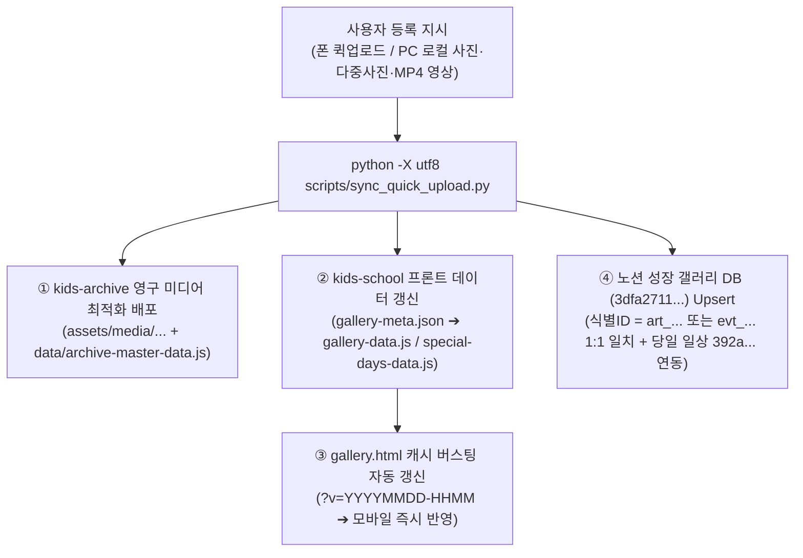

# 🎨 꿈나무 갤러리 · 특별한 날 · 성장 아카이브 상세 명세서 (Gallery & Growth Archive Spec)

> **문서 버전**: v2.2.0 (2026-10-27 기준)  
> **관할 도메인**: 꿈나무 갤러리 웹(`gallery.html`), 특별한 날 추억 피드(`special-days-data.js`, `haru-special-days.js`), 12년 성장 미디어 단일 원천(`kids-archive`), 원클릭 통합 파이프라인(`scripts/sync_quick_upload.py`)  
> **상위 헌법**: `g:/master-tower/GEMINI.md`, `kids-school-main/GEMINI.md`  
> **연계 명세서**: [`docs/timetable_diary_spec.md`](timetable_diary_spec.md) (종이일기·일기장 격리 규칙), [`docs/haru_spec.md`](haru_spec.md) (하루방 특별한 날 연계)

---

## 0. 🚨 단발성(무덤) 스크립트 작성 절대 금지 & 단일 도구 원칙

어느 대화방에서든 사용자가 **"갤러리 작품 등록해줘"**, **"특별한 날에 등록해줘"**, **"사진 묶어서 등록해줘"**, **"퀵업로드 등록해줘"**라고 지시하면:
1. **`scripts/`나 임시 폴더에 일회성 Python 스크립트(`process_*.py`, `register_*_notion.py` 등)를 새로 짜지 않는다.**
2. 반드시 관제탑 루트의 공식 단일 파이프라인 **`python -X utf8 scripts/sync_quick_upload.py`** 하나로 처리한다.
3. 만약 파이프라인에 새 옵션이 필요하면 단발성 스크립트를 만들지 말고 `scripts/sync_quick_upload.py` 본체를 개선한다.

---

## 1. 시스템 핵심 아키텍처 & 4대 필수 동기화 계약 (4-Point Sync Contract)

갤러리 작품(`--type art`)과 특별한 날(`--type special`) 등록은 아래 **4곳이 동시에 일치**해야 웹과 모바일 화면, 노션에서 누락 없이 표시됩니다. `scripts/sync_quick_upload.py`는 이 4단계를 1회 실행으로 자동 완결합니다.



### 🛡️ 4대 필수 무결성 계약 (위반 시 모바일 화면 미노출 또는 일기장 오염 발생)
1. **웹 데이터(`gallery-data.js` / `special-days-data.js`) 누락 금지**:
   - 노션(`3dfa2711...`)과 `kids-archive`에만 올리고 `gallery-meta.json` + `build_gallery.py`(`gallery-data.js`)를 갱신하지 않으면 **공부앱 갤러리(`gallery.html`)에 카드가 절대 나타나지 않는다.** (`gallery-data-sync.js`는 `DEFAULT_GALLERY_DATA`에 존재하는 카드를 기준으로 노션과 동기화함)
2. **노션 `식별ID` 1:1 완전 일치 계약**:
   - 노션 성장 갤러리 DB(`3dfa27115b688010a85be385f91d64ee`)의 제목 속성인 **`식별ID`**는 반드시 프론트엔드 데이터의 `id`와 **글자 하나 틀리지 않고 1:1로 일치**해야 한다.
   - 갤러리 작품: `art_{minsu|minseo|together}_{파일베이스명}` (예: `art_minsu_20261020_moodlight_real`)
   - 특별한 날: `evt_{minsu|minseo|together}_{날짜_슬러그}` (예: `evt_minseo_pet_trainer_20261022`)
   - ❌ 금지: `[작품] 민수_2026-10-25 (...)`처럼 임의의 한글 제목을 `식별ID`에 넣으면 웹-노션 양방향 동기화가 끊어진다.
3. **`특별한 날`과 `일기장` 엄격 분리 계약**:
   - 학교 행사·진로체험·나눔장터·가족 나들이 등 `특별한 날` 카드는 노션 `구분` 속성을 반드시 **`특별한 날`**로 지정한다 (`일기`·`마음일기` 지정 금지).
   - 민서/민수 일기장(`kids/core/daily-diary.js`)은 `구분`이 `마음일기`·`일기`·`종이일기`인 항목만 표시하며, `특별한 날`과 `작품`은 일기장에 섞이지 않도록 게이트키퍼로 차단되어 있다.
4. **모바일 브라우저 캐시 버스팅(`gallery.html?v=...`)**:
   - `gallery-data.js`나 `special-days-data.js`가 바뀌면 `kids/common_space/gallery.html` 하단 `<script src="../data/gallery-data.js?v=...">` 버전 쿼리가 함께 갱신되어야 스마트폰에서 새로고침 시 즉시 새 작품이 뜬다 (`sync_quick_upload.py`가 자동 갱신).

---

## 2. 핵심 파일 맵 및 저장소 구조 (File Map)

| 위치 / 저장소 | 파일 경로 | 핵심 역할 |
| :--- | :--- | :--- |
| **`master-tower`** | [`scripts/sync_quick_upload.py`](file:///g:/master-tower/scripts/sync_quick_upload.py) | **[공식 단일 진입점] 폰 퀵업로드 + 로컬 사진/다중사진/동영상 + 노션 Upsert + 양쪽 Git 푸시 통합 실행기** |
| **`kids-school`** | [`kids-school-main/scripts/build_gallery.py`](file:///g:/master-tower/kids-school-main/scripts/build_gallery.py) | `uploads/ex/갤러리/` 스캔 ➔ 1200px EXIF 보정 리사이즈 ➔ `kids-archive` 배포 ➔ `gallery-data.js` & `archive-master-data.js` 생성 (`subImages`, `videoUrl`, `videoBtnText` 지원) |
| **`kids-school`** | [`kids/data/gallery-meta.json`](file:///g:/master-tower/kids-school-main/kids/data/gallery-meta.json) | 개별 작품 커스텀 메타데이터 (`title`, `category`, `date`, `grade`, `artistNote`, `subImages`, `videoUrl`, `videoBtnText`) |
| **`kids-school`** | [`kids/data/gallery-data.js`](file:///g:/master-tower/kids-school-main/kids/data/gallery-data.js) | 프론트엔드 갤러리 작품 마스터 데이터 (`DEFAULT_GALLERY_DATA`) |
| **`kids-school`** | [`kids/data/special-days-data.js`](file:///g:/master-tower/kids-school-main/kids/data/special-days-data.js) | 프론트엔드 특별한 날 추억 마스터 데이터 (`DEFAULT_SPECIAL_DAYS_DATA`) |
| **`kids-school`** | [`kids/common_space/gallery.html`](file:///g:/master-tower/kids-school-main/kids/common_space/gallery.html) | 꿈나무 갤러리 & 특별한 날 통합 뷰포트 |
| **`kids-school`** | [`kids/common_space/gallery_controller.js`](file:///g:/master-tower/kids-school-main/kids/common_space/gallery_controller.js) | 갤러리/특별한 날 탭 전환, 필터, 카드 그리드 렌더러 |
| **`kids-school`** | [`kids/common_space/gallery-data-sync.js`](file:///g:/master-tower/kids-school-main/kids/common_space/gallery-data-sync.js) | 로컬 스토리지 및 노션 DB(`3dfa2711...`) 실시간 양방향 동기화 |
| **`kids-school`** | [`kids/common_space/gallery-modal-manager.js`](file:///g:/master-tower/kids-school-main/kids/common_space/gallery-modal-manager.js) | 상세 모달 뷰어 (다중 사진 썸네일 스위처 + `🎬 3D 회전영상` 인라인 `<video>` 플레이어 지원) |
| **`kids-archive`** | [`kids-archive/data/archive-master-data.js`](file:///g:/master-tower/kids-archive/data/archive-master-data.js) | 12년 성장 포트폴리오 마스터 DB |
| **`kids-archive`** | `kids-archive/assets/media/{minsu|minseo|together}/` | 웹 최적화된 고화질 영구 사진(`.jpg`/`.png`) 및 영상(`.mp4`) |

---

## 3. 상황별 표준 실행 명령어 (Copy-Paste Standard Recipes)

모든 명령은 관제탑 루트(`g:/master-tower`)에서 실행합니다.

### ① 스마트폰 퀵업로드 대기 큐 자동 수신 & 배포
```bash
python -X utf8 scripts/sync_quick_upload.py
```

### ② PC 로컬 사진(단일/다중) + MP4 동영상 묶음 ➔ [갤러리 작품] 원클릭 등록
사용자가 다운로드 폴더(`E:\Downloads\...` 등)에 있는 작품 사진 1장 또는 여러 장, 회전 동영상(`.mp4`)을 주며 갤러리에 등록해 달라고 할 때:
```bash
python -X utf8 scripts/sync_quick_upload.py \
  --type art \
  --author "민수" \
  --cat "만들기/공예" \
  --date "2026-10-25" \
  --id "art_minsu_20261020_moodlight_real" \
  --title "은하수 달님과 별빛 마을 원통 무드등 (실물 & 도안 & 3D 회전영상)" \
  --file "E:/Downloads/Mobile Devices/20261020_165921.jpg" \
  --sub-files "E:/Downloads/Mobile Devices/20261025_114413.jpg" \
  --video "C:/Users/pc/Downloads/Rotating_cylindrical_artwork.mp4" \
  --video-btn "3D 회전 AI 영상 감상하기 🔄" \
  --note "검은색 도화지에 집과 나무, 달님과 은하수를 그려 완성한 원통 무드등 작품입니다."
```
- `--file`과 `--sub-files`는 자동으로 `kids-school-main/uploads/ex/갤러리/{민수|민서}/`에 정식 파일명으로 복사됩니다.
- `--video`에 로컬 `.mp4` 경로를 넘기면 자동으로 `kids-archive/assets/media/...`에 복사되고 CDN URL이 `videoUrl`로 연결되어, 모달의 `🎬 3D 회전영상` 탭과 하단 버튼에서 인라인 재생됩니다.

### ③ 학교 행사·체험·가족 추억 ➔ [특별한 날] 원클릭 등록
사용자가 선생님 알림장 사진·글이나 가족 행사 사진을 주며 **"특별한 날에 등록해줘"**라고 할 때:
```bash
python -X utf8 scripts/sync_quick_upload.py \
  --type special \
  --author "민서" \
  --cat "학교생활/진로" \
  --date "2026-10-22" \
  --id "evt_minseo_pet_trainer_20261022" \
  --title "🐕 진로체험: 반려동물 훈련사와의 따뜻한 만남!" \
  --file "E:/Downloads/pet_trainer.jpg" \
  --note "진로주간을 맞아 1-2학년 친구들이 반려동물 훈련사 선생님과 함께한 뜻깊은 시간입니다."
```
- 자동으로 `kids-archive/assets/media/{자녀}/activities/`에 1200px 최적화 저장, `kids/data/special-days-data.js` 등록, `gallery.html` 캐시 버스팅, 노션 `3dfa2711...`(`구분: 특별한 날`) 카드 생성 및 양쪽 Git 푸시까지 한 번에 끝납니다.

### ④ 손글씨 종이일기 사진 등록
- 손글씨 종이일기는 갤러리 작품이 아니므로 [`docs/timetable_diary_spec.md` §5](timetable_diary_spec.md)에 명시된 전용 도구 `python -X utf8 scripts/sync_paper_diaries.py`를 사용합니다.
