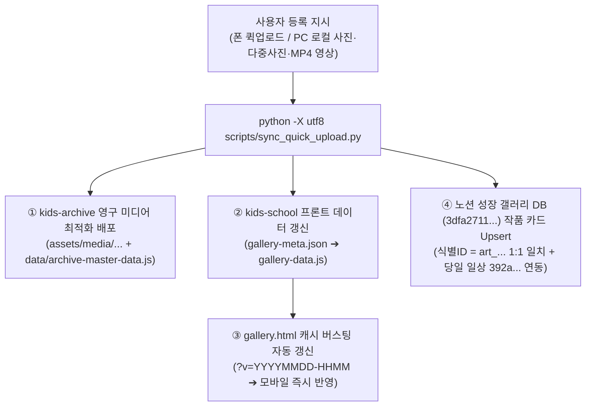

# 🎨 꿈나무 갤러리 · 성장 아카이브 상세 명세서 (Gallery & Growth Archive Spec)

> **문서 버전**: v2.3.0 (2026-10-27 기준)  
> **관할 도메인**: 꿈나무 갤러리 웹(`gallery.html`), 특별한 날 추억 피드(`special-days-data.js`, `haru-special-days.js`), 12년 성장 미디어 단일 원천(`kids-archive`), 작품 등록 도구(`scripts/sync_quick_upload.py`)  
> **상위 헌법**: `g:/master-tower/GEMINI.md`, `kids-school-main/GEMINI.md`  
> **연계 명세서**: [`docs/timetable_diary_spec.md`](timetable_diary_spec.md) (종이일기·일기장 격리 규칙), [`docs/haru_spec.md`](haru_spec.md) (하루방 특별한 날 연계)

---

## 0. 등록 도구 원칙

- 갤러리 작품 등록("갤러리 작품 등록해줘", "사진 묶어서 등록해줘", "퀵업로드 등록해줘")은 관제탑 루트의 **`python -X utf8 scripts/sync_quick_upload.py`** 하나로 처리한다.
- 등록할 때마다 일회성 스크립트(`process_*.py`, `register_*_notion.py` 등)를 새로 만들지 않는다. 옵션이 모자라면 `sync_quick_upload.py` 본체를 고친다.
- 특별한 날은 이 도구의 대상이 아니다 (§5).

---

## 1. 시스템 핵심 아키텍처 & 동기화 계약

### 1) kids-archive 영구 보존 단일 원천 원칙
- **12년 성장 기록 영구 보존**: 초등/중등/고등 12년간의 모든 작품, 상장, 활동 사진은 영구 보존용 단일 원천 레포지토리인 **`kids-archive`** (`https://github.com/awslike6-web/kids-archive`)에만 보관합니다.
- **공부방 레포지토리(kids-school) 0MB 경량화**: `kids-school`은 작품 사진을 내부에 저장하지 않으며, `kids-archive`의 GitHub CDN 링크(`https://raw.githubusercontent.com/awslike6-web/kids-archive/main/assets/media/...`)를 직접 참조합니다.

### 2) 작품 등록 흐름
갤러리 작품은 아래 4곳이 함께 맞아야 웹·모바일·노션에서 빠짐없이 보입니다. `sync_quick_upload.py`가 한 번에 처리합니다.



### 3) 지켜야 할 계약
1. **웹 데이터 누락 금지**: 노션(`3dfa2711...`)과 `kids-archive`에만 올리고 `gallery-meta.json` + `build_gallery.py`(`gallery-data.js`)를 갱신하지 않으면 **공부앱 갤러리(`gallery.html`)에 카드가 나타나지 않는다.** (`gallery-data-sync.js`는 `DEFAULT_GALLERY_DATA`에 있는 카드를 기준으로 노션과 동기화함)
2. **노션 `식별ID` 1:1 일치**:
   - 노션 성장 갤러리 DB(`3dfa27115b688010a85be385f91d64ee`)의 제목 속성 **`식별ID`**는 프론트엔드 데이터의 `id`와 글자 하나 틀리지 않고 같아야 한다.
   - 갤러리 작품: `art_{minsu|minseo|together}_{파일베이스명}` (예: `art_minsu_20261020_moodlight_real`)
   - 특별한 날: `evt_...` (예: `evt_minseo_pet_trainer_20261022`)
   - ❌ 금지: `[작품] 민수_2026-10-25 (...)`처럼 한글 제목을 `식별ID`에 넣으면 웹-노션 동기화가 끊어진다. (예외: 폰 퀵업로드 임시 카드, §6)
   - 노션 카드에 쓰는 속성 이름은 [`docs/notion_schemas_school.md`](notion_schemas_school.md)의 `3dfa2711...` 표에 있는 것만 쓴다. `분야`(카테고리) 속성은 노션에 없으므로 `gallery-meta.json`에만 둔다.
3. **일기장 분리**: 민서/민수 일기장(`kids/core/daily-diary.js`)은 `구분`이 `마음일기`·`일기`·`종이일기`인 항목만 표시한다. 작품 카드는 `구분: 작품`, 특별한 날 카드는 `구분: 특별한 날`로 지정해 일기장에 섞이지 않게 한다.
4. **모바일 캐시 버스팅**: `gallery-data.js`가 바뀌면 `kids/common_space/gallery.html` 하단 `<script src="../data/gallery-data.js?v=...">` 버전 쿼리도 함께 바뀌어야 스마트폰에서 새로고침 시 바로 새 작품이 뜬다 (`sync_quick_upload.py`가 자동 갱신).

---

## 2. 핵심 파일 맵 및 저장소 구조 (File Map)

| 위치 / 저장소 | 파일 경로 | 핵심 역할 |
| :--- | :--- | :--- |
| **`master-tower`** | [`scripts/sync_quick_upload.py`](file:///g:/master-tower/scripts/sync_quick_upload.py) | **[작품 등록 진입점] 폰 퀵업로드 + 로컬 사진/다중사진/동영상 + 노션 작품 카드 Upsert + 양쪽 Git 푸시**. 노션 실패 시 ❌ 원문을 보여 주고 종료 코드 1 |
| **`kids-school`** | [`kids-school-main/scripts/build_gallery.py`](file:///g:/master-tower/kids-school-main/scripts/build_gallery.py) | `uploads/ex/갤러리/` 스캔 ➔ 1200px EXIF 보정 리사이즈 ➔ `kids-archive` 배포 ➔ `gallery-data.js` & `archive-master-data.js` 생성 (`subImages`, `videoUrl`, `videoBtnText` 지원) |
| **`kids-school`** | [`kids/data/gallery-meta.json`](file:///g:/master-tower/kids-school-main/kids/data/gallery-meta.json) | 개별 작품 커스텀 메타데이터 (`title`, `category`, `date`, `grade`, `artistNote`, `subImages`, `videoUrl`, `videoBtnText`) |
| **`kids-school`** | [`kids/data/gallery-data.js`](file:///g:/master-tower/kids-school-main/kids/data/gallery-data.js) | 프론트엔드 갤러리 작품 마스터 데이터 (`DEFAULT_GALLERY_DATA`) |
| **`kids-school`** | [`kids/data/special-days-data.js`](file:///g:/master-tower/kids-school-main/kids/data/special-days-data.js) | 프론트엔드 특별한 날 추억 마스터 데이터 (`DEFAULT_SPECIAL_DAYS_DATA`) |
| **`kids-school`** | [`kids/common_space/gallery.html`](file:///g:/master-tower/kids-school-main/kids/common_space/gallery.html) | 꿈나무 갤러리 & 특별한 날 통합 뷰포트 |
| **`kids-school`** | [`kids/common_space/gallery_controller.js`](file:///g:/master-tower/kids-school-main/kids/common_space/gallery_controller.js) | 갤러리/특별한 날 탭 전환, 필터, 카드 그리드 렌더러 |
| **`kids-school`** | [`kids/common_space/gallery-data-sync.js`](file:///g:/master-tower/kids-school-main/kids/common_space/gallery-data-sync.js) | 로컬 스토리지 및 노션 DB(`3dfa2711...`) 실시간 양방향 동기화 |
| **`kids-school`** | [`kids/common_space/gallery-modal-manager.js`](file:///g:/master-tower/kids-school-main/kids/common_space/gallery-modal-manager.js) | 상세 모달 뷰어 (다중 사진 썸네일 스위처 + `🎬 3D 회전영상` 인라인 `<video>` 플레이어 지원) |
| **`kids-school`** | [`kids/common_space/gallery.css`](file:///g:/master-tower/kids-school-main/kids/common_space/gallery.css) | 갤러리 전용 3D 카드, 필터 바, 라이트박스 반응형 스타일 |
| **`kids-archive`** | [`kids-archive/data/archive-master-data.js`](file:///g:/master-tower/kids-archive/data/archive-master-data.js) | 12년 성장 포트폴리오 마스터 DB |
| **`kids-archive`** | `kids-archive/assets/media/{minsu|minseo|together}/` | 웹 최적화된 고화질 영구 사진(`.jpg`/`.png`) 및 영상(`.mp4`) |

---

## 3. 상황별 실행 명령어

모든 명령은 관제탑 루트(`g:/master-tower`)에서 실행합니다.

### ① 폰 퀵업로드 2단계
- **1단계 (폰, 현장)**: 스마트폰 브라우저에서 퀵업로더 접속 ➔ 사진 촬영/선택 ➔ 자녀(민서/민수) 선택 ➔ 메모 작성 ➔ 전송. Cloudflare Worker(`workers/minmin-notion`)가 사진을 대기 큐에 넣고 노션 성장 DB에 임시 카드를 만든다:
  - `식별ID`: `[퀵업로드] 자녀_YYYY-MM-DD (메모)`
  - `구분`: 업로드 때 고른 분류(`작품`, `종이일기` 등), `주인공`: `민서`·`민수`(엄마·아빠는 `부모관리자`)
- **2단계 (PC)**: 사용자가 **"퀵업로드 올린 거 등록해줘"**라고 하면 아래 명령을 1회 실행한다. 대기 큐 사진을 `uploads/ex/`로 내려받아 `gallery-meta.json`에 등록하고, 빌드·캐시 버스팅·양쪽 Git 푸시까지 끝낸다.
```bash
python -X utf8 scripts/sync_quick_upload.py
```

### ② PC 로컬 사진(단일/다중) + MP4 동영상 ➔ 갤러리 작품 등록
사용자가 다운로드 폴더(`E:\Downloads\...` 등)의 작품 사진 1장 또는 여러 장, 회전 동영상(`.mp4`)을 주며 갤러리에 등록해 달라고 할 때:
```bash
python -X utf8 scripts/sync_quick_upload.py \
  --author "민수" \
  --cat "만들기/공예" \
  --date "2026-10-25" \
  --id "art_minsu_20261020_moodlight_real" \
  --title "은하수 달님과 별빛 마을 원통 무드등 (실물 & 도안 & 3D 회전영상)" \
  --file "E:/Downloads/Mobile Devices/20261020_165921.jpg" \
  --sub-files "E:/Downloads/Mobile Devices/20261025_114413.jpg" \
  --video "C:/Users/pc/Downloads/Rotating_cylindrical_artwork.mp4" \
  --video-btn "3D 회전 AI 영상 감상하기 🔄" \
  --note "검은색 도화지에 집과 나무, 달님과 은하수를 그려 완성한 원통 무드등 작품입니다."
```
- `--file`과 `--sub-files`는 `kids-school-main/uploads/ex/갤러리/{민수|민서}/`에 정식 파일명으로 복사됩니다.
- `--video`에 로컬 `.mp4` 경로를 넘기면 `kids-archive/assets/media/...`에 복사되고 CDN URL이 `videoUrl`로 연결되어, 모달의 `🎬 3D 회전영상` 탭과 하단 버튼에서 인라인 재생됩니다.
- 노션 카드 등록이 실패하면 마지막 줄에 `⚠️ [일부 실패]`가 뜨고 종료 코드가 1입니다. 이때는 완료로 보고하지 말고 ❌ 메시지(노션 오류 원문)를 그대로 보고한다.

### ③ 손글씨 종이일기 사진
- 종이일기는 갤러리 작품이 아니므로 [`docs/timetable_diary_spec.md` §5](timetable_diary_spec.md)의 전용 도구 `python -X utf8 scripts/sync_paper_diaries.py`를 사용합니다.

---

## 4. 다중 사진 번들링 (사진 2장 이상 1개 카드 묶기)

- **원칙**: 수료증(표지+본문), 만들기 과정 사진, 입체 작품 등 같은 대상의 사진이 2장 이상이면 갤러리 카드를 여러 개로 쪼개지 않고 **1개의 카드로 묶습니다.**
- **구현 방식**:
  - 등록 도구에서는 대표 사진을 `--file`, 나머지를 `--sub-files`(쉼표 구분)로 넘긴다. 이미 `uploads/ex/갤러리/`에 있는 파일이면 `--sub`에 파일명만 쓴다.
  - 결과적으로 `gallery-meta.json`의 해당 작품 항목에 `"subImages": ["파일명2.jpg", "파일명3.jpg"]`가 기록된다.
  - 빌더가 이를 `galleryImages` 배열로 묶고, 갤러리 카드에 **`📷 N장` 배지**와 모달 썸네일 스위처를 자동으로 만든다.

---

## 5. 특별한 날 (현재 상태)

- **화면**: `kids/data/special-days-data.js`(`DEFAULT_SPECIAL_DAYS_DATA`)를 갤러리의 특별한 날 탭과 하루방(`haru-special-days.js`, [`docs/haru_spec.md`](haru_spec.md))이 읽는다.
- **노션**: 성장 갤러리 DB(`3dfa2711...`)에 `구분: 특별한 날`, `식별ID`는 데이터의 `evt_...` id와 같게 둔다.
- **등록 도구는 아직 없다.** 관제탑 `scripts/sync_haru_special_days_notion.py`는 스크립트 안에 적힌 초기 4건만 노션에 올리는 도구라 새 행사 등록에는 맞지 않는다. 특별한 날 등록 요청이 오면 일회성 스크립트를 만들지 말고, 도구가 없다는 사실을 사용자에게 알리고 등록 도구를 만들지 먼저 정한다.

---

## 6. 알려진 한계

- **폰 퀵업로드의 노션 카드 이름**: 1단계에서 Worker가 만든 임시 카드의 `식별ID`는 `[퀵업로드] ...` 형식이고, 2단계(`sync_quick_upload.py`, 옵션 없이 실행)는 이 카드를 `art_...` id로 바꾸지 않는다. 그래서 퀵업로드로 들어온 작품은 웹 데이터와 노션 카드의 `식별ID`가 다르다. 고칠 때는 2단계에서 임시 카드를 찾아 `식별ID`를 `art_...`로 바꾸는 쪽으로 `sync_quick_upload.py`를 고친다.
