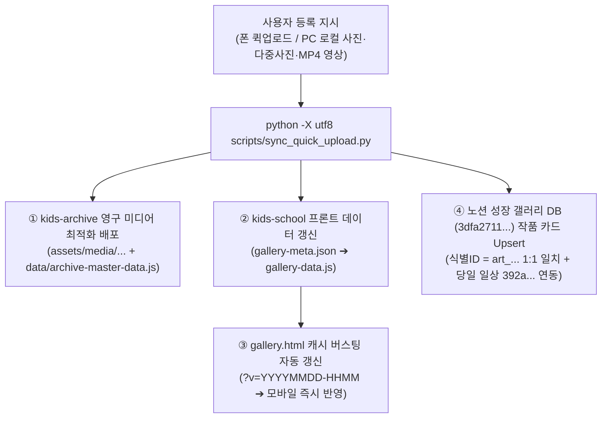

# 🎨 꿈나무 갤러리 · 성장 아카이브 상세 명세서 (Gallery & Growth Archive Spec)

> **문서 버전**: v2.8.0 (2026-10-29 기준, 자작 캐릭터 파트너·미니 런 추가)
> **관할 도메인**: 꿈나무 갤러리 웹(`gallery.html`), 특별한 날 추억 피드(`special-days-data.js`, `haru-special-days.js`), 12년 성장 미디어 단일 원천(`kids-archive`), 작품·특별한 날 등록 도구(`scripts/sync_quick_upload.py` → `build_gallery.py` / `add_activity_photo.py`)  
> **상위 헌법**: `g:/master-tower/GEMINI.md`, `kids-school-main/GEMINI.md`  
> **연계 명세서**: [`docs/timetable_diary_spec.md`](timetable_diary_spec.md) (종이일기·일기장 격리 규칙), [`docs/haru_spec.md`](haru_spec.md) (하루방 특별한 날 연계)

---

## 0. 등록 도구 원칙

- 갤러리 작품 등록("갤러리 작품 등록해줘", "사진 묶어서 등록해줘", "퀵업로드 등록해줘")은 관제탑 루트의 **`python -X utf8 scripts/sync_quick_upload.py`** 하나로 처리한다.
- 등록할 때마다 일회성 스크립트(`process_*.py`, `register_*_notion.py` 등)를 새로 만들지 않는다. 옵션이 모자라면 `sync_quick_upload.py` 본체를 고친다.
- 특별한 날 등록("특별한 날 등록해줘", "행사 사진 올려줘")도 같은 입구 `sync_quick_upload.py`(`--cat "특별한 날"`, 폰 큐 `구분: 특별한 날`)로 한다. 입구가 빌더 `kids-school-main/scripts/add_activity_photo.py`를 불러 쓴다 (§5). `special-days-data.js`를 손으로 고치거나 행사 사진을 작품 경로(`build_gallery.py`)로 올리지 않는다.

---

## 1. 시스템 핵심 아키텍처 & 동기화 계약

### 1) kids-archive 영구 보존 단일 원천 원칙
- **12년 성장 기록 영구 보존**: 초등/중등/고등 12년간의 모든 작품, 상장, 활동 사진은 영구 보존용 단일 원천 레포지토리인 **`kids-archive`** (`https://github.com/awslike6-web/kids-archive`)에만 보관합니다.
- **공부방 레포지토리(kids-school) 0MB 경량화**: `kids-school`은 작품 사진을 내부에 저장하지 않으며, `kids-archive`의 GitHub CDN 링크(`https://raw.githubusercontent.com/awslike6-web/kids-archive/main/assets/media/...`)를 직접 참조합니다.

### 2) 작품 등록 흐름
갤러리 작품은 아래 4곳이 함께 맞아야 웹·모바일·노션에서 빠짐없이 보입니다. `sync_quick_upload.py`가 한 번에 처리합니다.



### 3) 지켜야 할 계약
1. **웹 데이터 누락 금지**: 노션(`3dfa2711...`)과 `kids-archive`에만 올리고 `gallery-meta.json` + `build_gallery.py`(`gallery-data.js`)를 갱신하지 않으면 **공부앱 갤러리(`gallery.html`)에 카드가 나타나지 않는다.** (`gallery-data-sync.js`는 `DEFAULT_GALLERY_DATA`에 있는 카드를 기준으로 노션과 동기화함)
2. **노션 `식별ID` 1:1 일치**:
   - 노션 성장 갤러리 DB(`3dfa27115b688010a85be385f91d64ee`)의 제목 속성 **`식별ID`**는 프론트엔드 데이터의 `id`와 글자 하나 틀리지 않고 같아야 한다.
   - 갤러리 작품: `art_{minsu|minseo|together}_{파일베이스명}` (예: `art_minsu_20261020_moodlight_real`)
   - 특별한 날: `evt_...` (예: `evt_minseo_pet_trainer_20261022`)
   - ❌ 금지: `[작품] 민수_2026-10-25 (...)`처럼 한글 제목을 `식별ID`에 넣으면 웹-노션 동기화가 끊어진다. (폰 퀵업로드 임시 카드 `[퀵업로드] ...`는 PC 등록 때 `art_...`로 바뀐다, §3①)
   - 노션 카드에 쓰는 속성 이름은 [`docs/notion_schemas_school.md`](notion_schemas_school.md)의 `3dfa2711...` 표에 있는 것만 쓴다. `분야`(카테고리) 속성은 노션에 없으므로 `gallery-meta.json`에만 둔다.
3. **당일 일상 연결**: 작품 카드의 `AI 대화록 및 일상 기록 DB` 연결은 작품 날짜의 일상 페이지(`392a...`)로 한다. 오늘 작품인데 그날 일상 페이지가 아직 없으면 `sync_quick_upload.py`가 개발 타임라인 기록과 같은 함수(`log_dev_timeline.get_or_create_daily_log_page`)로 만들어 연결한다. 지난 날짜는 있는 페이지만 연결하고, 없으면 경고만 하고 비워 둔다(2026-10-28, 작품 등록이 그날 첫 작업이라 연결이 빠지던 문제).
4. **일기장 분리**: 민서/민수 일기장(`kids/core/daily-diary-base.js` → `daily-diary-forms.js` → `daily-diary-sync.js` → `daily-diary-submit.js`, 클래식 스크립트 순차 로드)의 조회·파서·동기화는 `daily-diary-sync.js`가 맡으며 `구분`이 `마음일기`·`일기`·`종이일기`인 항목만 표시한다. 작품 카드는 `구분: 작품`, 특별한 날 카드는 `구분: 특별한 날`로 지정해 일기장에 섞이지 않게 한다.
5. **모바일 캐시 버스팅**: `gallery-data.js`가 바뀌면 `kids/common_space/gallery.html` 하단 `<script src="../data/gallery-data.js?v=...">` 버전 쿼리도 함께 바뀌어야 스마트폰에서 새로고침 시 바로 새 작품이 뜬다 (`sync_quick_upload.py`가 자동 갱신).

---

## 2. 핵심 파일 맵 및 저장소 구조 (File Map)

| 위치 / 저장소 | 파일 경로 | 핵심 역할 |
| :--- | :--- | :--- |
| **`master-tower`** | [`scripts/sync_quick_upload.py`](file:///g:/master-tower/scripts/sync_quick_upload.py) | **[작품·특별한 날 등록 진입점] 폰 퀵업로드 + 로컬 사진/다중사진/동영상 + 노션 카드 Upsert + 양쪽 Git 푸시**. 특별한 날은 빌더 `add_activity_photo.py`로 넘김(§5). 노션 실패 시 ❌ 원문을 보여 주고 종료 코드 1 |
| **`kids-school`** | [`kids-school-main/scripts/build_gallery.py`](file:///g:/master-tower/kids-school-main/scripts/build_gallery.py) | `uploads/ex/갤러리/` 스캔 ➔ 1200px EXIF 보정 리사이즈 ➔ `kids-archive` 배포 ➔ `gallery-data.js` & `archive-master-data.js` 생성 (`subImages`, `videoUrl`, `videoBtnText` 지원) |
| **`kids-school`** | [`kids/data/gallery-meta.json`](file:///g:/master-tower/kids-school-main/kids/data/gallery-meta.json) | 개별 작품 커스텀 메타데이터 (`title`, `category`, `date`, `grade`, `artistNote`, `subImages`, `videoUrl`, `videoBtnText`) |
| **`kids-school`** | [`kids/data/gallery-data.js`](file:///g:/master-tower/kids-school-main/kids/data/gallery-data.js) | 프론트엔드 갤러리 작품 마스터 데이터 (`DEFAULT_GALLERY_DATA`) |
| **`kids-school`** | [`kids-school-main/scripts/add_activity_photo.py`](file:///g:/master-tower/kids-school-main/scripts/add_activity_photo.py) | **[특별한 날 빌더]** 사진 EXIF 보정·1200px ➔ `kids-archive/.../activities/` ➔ `special-days-data.js`·`archive-master-data.js` id upsert ➔ `?v=` 갱신. 입구 `sync_quick_upload.py`가 불러 씀 |
| **`kids-school`** | [`kids/data/special-days-data.js`](file:///g:/master-tower/kids-school-main/kids/data/special-days-data.js) | 특별한 날 추억 마스터 데이터 (`DEFAULT_SPECIAL_DAYS_DATA`) 단일 원천. 갤러리 특별한 날 탭과 하루방이 함께 읽음. 배열 본문은 JSON 형식 유지 |
| **`kids-school`** | [`kids/common_space/gallery.html`](file:///g:/master-tower/kids-school-main/kids/common_space/gallery.html) | 꿈나무 갤러리 & 특별한 날 통합 뷰포트 |
| **`kids-school`** | [`kids/common_space/gallery_controller.js`](file:///g:/master-tower/kids-school-main/kids/common_space/gallery_controller.js) | 갤러리/특별한 날 탭 전환, 필터, 카드 그리드 렌더러 |
| **`kids-school`** | [`kids/common_space/gallery-data-sync.js`](file:///g:/master-tower/kids-school-main/kids/common_space/gallery-data-sync.js) | 로컬 스토리지 및 노션 DB(`3dfa2711...`) 실시간 양방향 동기화 |
| **`kids-school`** | [`kids/common_space/gallery-modal-manager.js`](file:///g:/master-tower/kids-school-main/kids/common_space/gallery-modal-manager.js) | 상세 모달 뷰어 (다중 사진 썸네일 스위처 + `🎬 3D 회전영상` 인라인 `<video>` 플레이어 지원) |
| **`kids-school`** | [`kids/common_space/gallery.css`](file:///g:/master-tower/kids-school-main/kids/common_space/gallery.css) | 갤러리 전용 3D 카드, 필터 바, 라이트박스 반응형 스타일 |
| **`kids-school`** | `kids/common_space/gallery-spot-diff.js` | `GallerySpotDiff` 놀이·부모 좌표 추출·RGB 차이 검수. 모달 매니저보다 먼저 로드 |
| **`kids-school`** | `kids/common_space/gallery-mini-runner.js` | `GalleryMiniRunner` 장착 버튼·토스트·60초 미니 런·순수 물리 API |
| **`kids-school`** | `kids/subjects/quest/monster_roster.js` | 갤러리 파트너·최고 기록의 자녀별 로컬 저장 원천, 민수 로스터 동적 항목 |
| **`kids-archive`** | [`kids-archive/data/archive-master-data.js`](file:///g:/master-tower/kids-archive/data/archive-master-data.js) | 12년 성장 포트폴리오 마스터 DB |
| **`kids-archive`** | `kids-archive/assets/media/{minsu|minseo|together}/` | 웹 최적화된 고화질 영구 사진(`.jpg`/`.png`) 및 영상(`.mp4`) |

---

## 3. 상황별 실행 명령어

모든 명령은 관제탑 루트(`g:/master-tower`)에서 실행합니다.

### ① 폰 퀵업로드 2단계
- **1단계 (폰, 현장)**: 스마트폰 브라우저에서 퀵업로더(`kids/core/quick-uploader.js`) 접속 ➔ 사진 촬영/선택 ➔ 자녀(민서/민수) 선택 ➔ 메모 작성 ➔ 전송. Cloudflare Worker(`workers/minmin-notion`)가 노션 성장 DB에 임시 카드를 만들고, 그 카드 번호(`notionPageId`)와 함께 사진을 대기 큐에 넣는다:
  - `식별ID`: `[퀵업로드] 자녀_YYYY-MM-DD (메모)`
  - `구분`: 업로드 때 고른 분류(`작품`, `상장`, `종이일기`, `특별한 날`), `주인공`: `민서`·`민수`(엄마·아빠는 `부모관리자`)
- **2단계 (PC)**: 사용자가 **"퀵업로드 올린 거 등록해줘"**라고 하면 아래 명령을 1회 실행한다. 대기 큐 사진을 `uploads/ex/`로 내려받아 `gallery-meta.json`에 등록하고, 빌드·캐시 버스팅·양쪽 Git 푸시까지 끝낸다.
  - 작품·상장은 임시 카드의 `식별ID`를 `art_...`로, `구분`을 `작품`으로 바꾸고 사진 블록을 붙인다. 카드 번호가 없는 옛 큐 항목은 `art_...`로 찾아 갱신하거나 새로 만든다. 같은 `art_...` 카드가 이미 있으면 그 카드를 갱신하고, 남은 임시 카드는 노션에서 직접 지우라고 안내한다.
  - 노션까지 성공한 항목만 대기 큐에서 지운다. 실패한 항목은 큐에 남아 다음 실행 때 다시 처리된다.
  - 특별한 날 사진은 `uploads/ex/갤러리/하루아카이브/{민서|민수|공통}/`에 내려받아 빌더로 등록하고, 임시 카드를 `evt_...`로 바꾼다 (§5). 작품 메타(`gallery-meta.json`)에는 넣지 않는다.
  - 종이일기 임시 카드는 이 도구가 바꾸지 않는다 ([`timetable_diary_spec.md` §5](timetable_diary_spec.md)).
```bash
python -X utf8 scripts/sync_quick_upload.py
```

### ② PC 로컬 사진(단일/다중) + MP4 동영상 ➔ 갤러리 작품 등록
사용자가 다운로드 폴더(`E:\Downloads\...` 등)의 작품 사진 1장 또는 여러 장, 회전 동영상(`.mp4`)을 주며 갤러리에 등록해 달라고 할 때:
```bash
python -X utf8 scripts/sync_quick_upload.py \
  --author "민수" \
  --cat "만들기/공예" \
  --date "2026-10-25" \
  --id "art_minsu_20261020_moodlight_real" \
  --title "은하수 달님과 별빛 마을 원통 무드등 (실물 & 도안 & 3D 회전영상)" \
  --file "E:/Downloads/Mobile Devices/20261020_165921.jpg" \
  --sub-files "E:/Downloads/Mobile Devices/20261025_114413.jpg" \
  --video "C:/Users/pc/Downloads/Rotating_cylindrical_artwork.mp4" \
  --video-btn "3D 회전 AI 영상 감상하기 🔄" \
  --note "검은색 도화지에 집과 나무, 달님과 은하수를 그려 완성한 원통 무드등 작품입니다."
```
- `--file`과 `--sub-files`는 `kids-school-main/uploads/ex/갤러리/{민수|민서}/`에 정식 파일명으로 복사됩니다.
- `--video`에 로컬 `.mp4` 경로를 넘기면 `kids-archive/assets/media/...`에 복사되고 CDN URL이 `videoUrl`로 연결되어, 모달의 `🎬 3D 회전영상` 탭과 하단 버튼에서 인라인 재생됩니다.
- 노션 카드 등록이 실패하면 마지막 줄에 `⚠️ [일부 실패]`가 뜨고 종료 코드가 1입니다. 이때는 완료로 보고하지 말고 ❌ 메시지(노션 오류 원문)를 그대로 보고한다.

### ③ 손글씨 종이일기 사진
- 종이일기는 갤러리 작품이 아니므로 [`docs/timetable_diary_spec.md` §5](timetable_diary_spec.md)의 전용 도구 `python -X utf8 scripts/sync_paper_diaries.py`를 사용합니다.

### ④ 기존 작품에 틀린그림찾기 연결
```bash
python -X utf8 scripts/sync_quick_upload.py --id "art_minsu_20261028_paldo_bibimmyeon" --author "민수" --diff-file "E:/Downloads/paldo_diff.jpg" --diff-spots "E:/Downloads/spots.json"
```
- `--diff-file`: 로컬 변형 그림. `uploads/ex/갤러리/{작가}/{원본베이스}_diff{확장자}`로 복사합니다.
- `--diff-spots`: spots 배열 JSON 파일 경로를 우선으로 읽습니다. `[`로 시작하는 JSON 문자열도 허용합니다.
- 한 옵션만 지정하면 기존 `spotDiff`의 나머지 값을 유지합니다. 둘 다 생략하면 기존 값이 그대로 남습니다. 신규 연결은 두 값을 모두 채워야 합니다.
- 잘못된 좌표·없는 입력 파일은 복사·메타 저장·큐 처리 전에 종료 코드 1로 거절합니다. `--id`와 차이 옵션만으로 기존 작품을 갱신할 수 있으며 제목·날짜·설명을 보존합니다.
- `--no-push`는 원격 푸시만 생략하며 기존 도구의 로컬 커밋 동작은 유지합니다. 노션 시험은 임시 환경에서 큐 조회를 모의하고 제목 옵션 없이 실행합니다.

---

## 4. 다중 사진 번들링 (사진 2장 이상 1개 카드 묶기)

- **원칙**: 수료증(표지+본문), 만들기 과정 사진, 입체 작품 등 같은 대상의 사진이 2장 이상이면 갤러리 카드를 여러 개로 쪼개지 않고 **1개의 카드로 묶습니다.**
- **구현 방식**:
  - 등록 도구에서는 대표 사진을 `--file`, 나머지를 `--sub-files`(쉼표 구분)로 넘긴다. 이미 `uploads/ex/갤러리/`에 있는 파일이면 `--sub`에 파일명만 쓴다.
  - 결과적으로 `gallery-meta.json`의 해당 작품 항목에 `"subImages": ["파일명2.jpg", "파일명3.jpg"]`가 기록된다.
  - 빌더가 이를 `galleryImages` 배열로 묶고, 갤러리 카드에 **`📷 N장` 배지**와 모달 썸네일 스위처를 자동으로 만든다.

---

## 5. 특별한 날 등록

### 1) 원천과 화면
- **원천은 `kids/data/special-days-data.js`(`DEFAULT_SPECIAL_DAYS_DATA`) 하나다.** 갤러리 특별한 날 탭(`gallery-data-sync.js`)과 하루방(`haru-special-days.js`, [`docs/haru_spec.md`](haru_spec.md) §3-3)이 같은 목록을 읽는다. 2026-10-29 전에는 하루방이 `haru_data.js`의 따로 된 목록을 읽어 두 목록이 갈라졌다(하루방에만 사진 없는 예시 3건, 갤러리에만 10/18 이후 행사 3건).
- 하루방은 지금 아이(`민서`/`민수`)의 행사와 `공동`·`공통`·`아빠`·`엄마` 행사만 보여 준다. 갤러리는 전부 보여 준다.
- 항목 필드: `id`, `author`(민서·민수·공동·공통·아빠·엄마), `category`(갤러리 특별한 날 분류 6종), `categoryIcon`, `title`, `date`(YYYY-MM-DD), `desc`, `imageUrl`, `galleryImages`, `videoUrl`(+`videoBtnText`), 선택 `videos` 배열(하루방 영상 여러 편), `likes`, `stickers`, `comments`.

### 2) 등록 명령 (관제탑 루트에서)
- **폰**: 퀵업로더에서 `특별한 날/체험학습`을 고르고 메모를 적어 올린다 → PC에서 "퀵업로드 올린 거 등록해줘" = `python -X utf8 scripts/sync_quick_upload.py`. 같은 작성자·날짜·메모 사진은 행사 하나로 묶인다. 제목은 메모 첫 줄(`⭐ ...`), 분류는 `소중한 하루`로 들어가니 갤러리 화면 ✏️에서 고친다. 묶인 사진의 임시 카드 중 첫 장 카드를 `evt_...`로 바꾸고, 나머지 임시 카드는 노션에서 직접 지우라고 안내한다.
- **PC 사진**: 먼저 `--dry-run`으로 할 일을 확인하고, 같은 명령에서 `--dry-run`만 빼고 실행한다.
```bash
python -X utf8 scripts/sync_quick_upload.py --cat "특별한 날" --dry-run \
  --author "민서" --date "2026-10-22" --slug pet_trainer \
  --event-cat "학교행사/운동회" --icon "🐕" \
  --title "🐕 진로체험: 반려동물 훈련사와의 따뜻한 만남!" --note "알림장 본문" \
  --file "E:/Downloads/a.jpg" --sub-files "E:/Downloads/b.jpg,E:/Downloads/c.jpg" \
  --video "https://photos.app.goo.gl/..." --video-btn "🎬 그날의 영상 보기"
```
- `--author`: 민서·민수·공동·공통·아빠·엄마. `--event-cat`: 가족/생일파티·생태/텃밭/체험·소풍/현장학습·학교행사/운동회·사계절 자연관찰·소중한 하루(기본). `--slug`: id에 들어갈 영문 이름(없으면 첫 사진 파일 이름). 이미 있는 행사를 고칠 때는 `--id evt_...`.
- `--video`: 로컬 `.mp4/.mov/.webm`은 activities 폴더에 복사, http(s) 주소는 그대로 연결. 노션 카드에는 파일 영상만 동영상 블록으로 붙인다(구글 포토 링크는 데이터의 `videoUrl`로만).

### 3) 도구가 하는 일 (입구 `sync_quick_upload.py` → 빌더 `kids-school-main/scripts/add_activity_photo.py`)
1. **빌더**: EXIF 회전 보정·긴 변 1200px JPEG(quality 88) → `kids-archive/assets/media/{minseo|minsu|together}/activities/{아이}_{YYYYMMDD}_{slug}_{NN}.jpg`. `special-days-data.js`에 id `evt_{아이}_{slug}_{YYYYMMDD}`로 upsert(같은 id 재실행은 덮어쓰기, 중복 없음, `likes`·`stickers`·`comments` 보존, 신규는 날짜 순서 자리). `archive-master-data.js`에도 같은 id로 upsert(`build_gallery.py`는 다시 쓸 때 `evt_` 항목을 보존). `haru.html`·`gallery.html`의 `special-days-data.js?v=` 갱신.
2. **입구**: 노션 성장 갤러리 DB(`3dfa2711...`) 카드를 `upsert_notion_gallery_card`로 맞춘다. 속성은 `식별ID=evt_...`, `구분: 특별한 날`, `주인공`(아빠·엄마는 `부모관리자`), `날짜`, `제목`, `작가의 한마디/일기본문`(=desc), 당일 일상 연결(§1-3)만 쓴다. 노션까지 성공한 큐 항목만 큐에서 지운다.
3. **Git**: `kids-archive`(`assets/media`, `data/archive-master-data.js`)와 `kids-school`(`special-days-data.js`, `haru.html`, `gallery.html` 등 지정 파일만) 커밋·푸시. `--no-push`는 푸시만 생략.
- `--dry-run`은 특별한 날에서만 된다. 큐·파일·Git·노션을 건드리지 않고 id·사진 경로·넣을 항목·바뀔 파일을 출력한다. 빌더 단독 `python -X utf8 scripts/add_activity_photo.py --dry-run ...`(공부방 루트, `--category`)도 같다. 빌더 단독 실제 실행은 노션 카드를 만들지 않으므로 공식 등록은 입구로 한다.
- 시험 사진을 실제 `kids-archive`에 올리지 않는다(12년 보존 저장소). 도구 검증은 `--dry-run`과 임시 폴더·모의 노션으로 한다.

### 4) 미디어 폴더 계약
- 특별한 날·하루방 사진은 `kids-archive/assets/media/{아이}/activities/`, 작품은 학년 폴더(`2026_elem_1` 등)에 둔다. 같은 파일을 작품과 특별한 날에 함께 등록하지 않는다. `tests/media-archive-paths.test.mjs`가 검사한다(2026-10-29 행사 사진 2건이 작품 폴더에 들어간 사고 재발 방지).
- 관제탑 `scripts/sync_haru_special_days_notion.py`는 초기 4건만 올리던 옛 도구라 쓰지 않는다.

---

## 6. 노션 저장 규칙 (갤러리 화면)

- 갤러리 화면에서 작품·특별한 날의 제목·날짜·설명을 고치면 `gallery-data-sync.js`가 노션 카드의 `제목`·`날짜`·`작가의 한마디/일기본문`을 바꾸고, 바뀐 내용은 카드 본문에 수정 이력으로 남긴다.
- 분야(카테고리)·동영상 주소는 노션 DB에 속성이 없어 보내지 않는다. 없는 속성을 하나라도 보내면 노션이 저장 전체를 거부한다 (2026-10-27까지 이 문제로 화면 수정이 노션에 저장되지 않았음).
- 이 규칙은 공부방 회귀 시험 `tests/notion-contract.test.mjs`의 갤러리 시험이 지킨다.

## 7. 틀린그림찾기 등록

- 계약: [`gallery_spot_diff_spec.md`](gallery_spot_diff_spec.md). 메타의 선택 필드 `spotDiff`는 `modifiedImage` 파일명과 `spots` 배열입니다. 화면 결과는 `modifiedImageUrl`과 `spots`입니다. 노션 속성·블록 및 아카이브 포트폴리오 데이터에 넣지 않습니다.
- 정답 3~5곳, `x/y` 0~1, `r` 0.03~0.15(그림의 짧은 변 비율), 힌트 1~30자입니다. 빌더는 소수 셋째 자리로 반올림합니다.
- 변형 파일은 단독 카드로 만들지 않습니다. EXIF 보정 후 RGB/JPEG 품질 85로 원본 결과와 같은 픽셀 크기에 맞춥니다. 비율 차이가 1%를 넘거나 누끼 작품이면 제외합니다. 업로드 파일이 없으면 변환된 아카이브 파일을 확인합니다. 오류 시 `⚠️ [spotDiff 제외] {art_id}: {이유}`를 출력하고 작품 카드는 유지합니다.

부모 제작 절차:
1. **AI 편집**: 원본 사진과 함께 「구도·시점·색감은 그대로 두고 지정한 곳만 바꿔 줘」라고 요청합니다. 민서는 크고 분명한 차이 3곳, 민수는 작은 차이 4~5곳을 권장합니다.
2. **분석**: 공부방 루트에서 다음 명령으로 자동 맞춤·후보·검수 그림을 만듭니다. `--id`는 최종 아카이브 원본을 로컬에서 읽습니다. 등록 전 작품은 `--original "원본 경로"`를 씁니다.
   ```bash
   python -X utf8 scripts/spot_diff_align.py analyze --id "art_..." --ai "E:/Downloads/gemini_edit.webp"
   ```
   기본 작업 폴더는 `uploads/ex/갤러리/_spotdiff_work/{id 또는 원본파일명}/`입니다. `review.jpg`를 열고 품질 수치를 `report.json`에서 확인합니다. 실패하면 AI 편집을 다시 요청합니다.
3. **정답 선택**: `candidates.json`을 복사해 `spots.json`으로 저장합니다. 워터마크 등 불필요한 후보를 지우고 붙은 후보는 나누며 힌트 1~30자를 적습니다. 후보의 빈 힌트는 자동 등록을 막기 위한 것입니다. 옮긴 물건은 원래 자리도 확인합니다.
4. **합성**: 같은 원본·AI 파일과 선택한 좌표로 실행합니다.
   ```bash
   python -X utf8 scripts/spot_diff_align.py compose --id "art_..." --ai "E:/Downloads/gemini_edit.webp" --spots "작업폴더/spots.json"
   ```
   `{원본베이스}_diff.jpg`와 `check.jpg`, 갱신된 `report.json`이 나옵니다. 원본과 크기가 같은지, 워터마크·예상 밖의 변화·두 겹 선·색 띠가 없는지 직접 확인합니다. 노란 점선은 선택하지 않아 원본으로 돌린 큰 변화입니다. 물건의 예전 자리라면 좌표를 보완합니다. `--no-color-match`로 색 맞춤을 끌 수 있습니다.
5. **등록**: 검수 후 도구가 출력한 `--diff-file`·`--diff-spots` 경로를 §3④의 기존 관제탑 명령에 넣습니다. 맞춤 도구는 노션·Worker·Git·네트워크에 접근하거나 등록을 실행하지 않습니다.
6. **확인**: 등록 후 배포된 갤러리에서 한 판을 끝까지 진행합니다. 보석·사탕·학습시간·진행 기록은 지급·저장하지 않습니다.

자동 후보가 맞지 않을 때는 기존 **부모 관리자 좌표 추출기**를 보조로 씁니다. 로컬 `gallery-data.js`의 해당 작품에 미리보기에서 읽을 수 있는 `spotDiff.modifiedImageUrl`과 빈 `spots`를 임시로 넣고 아빠·엄마 계정으로 `gallery.html?admin=diff`를 엽니다. 원본 또는 변형 그림에서 좌표·반지름·힌트를 편집하고 「spots 전체 복사」를 누릅니다. 복사가 막히면 선택된 텍스트 영역을 복사합니다. 「차이 보기」로 검수한 뒤 임시 데이터 수정을 되돌립니다. 아이 계정에서는 이 관리자 모드가 켜지지 않습니다.

자동 맞춤의 품질 기준·출력 계약·한계는 [`gallery_spot_diff_align_spec.md`](gallery_spot_diff_align_spec.md)를 참고합니다. NumPy·OpenCV·Pillow를 쓰며 OpenCV가 없으면 `python -m pip install opencv-python-headless`를 안내합니다. 작업 폴더와 검수 그림은 커밋하지 않습니다.

## 8. 자작 캐릭터 파트너·미니 런 등록

1. 아이의 캐릭터 그림이나 인형 사진에서 배경을 지워 **캐릭터 하나만 남긴 투명 PNG**를 준비합니다. 완전 투명 픽셀이 10% 이상이어야 합니다. 손·책상·불필요한 배경이 남지 않았는지 직접 확인합니다.
2. 이미 등록된 작품 ID에 다음 옵션으로 붙입니다. 두 옵션 중 하나만 주면 기존 `character`의 나머지 값은 유지합니다. 이름은 앞뒤 공백을 뺀 1~12자입니다.
   ```bash
   python -X utf8 scripts/sync_quick_upload.py --id "art_..." --author "민수" --character-key "main" --character-sprite "E:/Downloads/dragon.png" --character-name "보라 용"
   ```
3. 도구는 `uploads/ex/갤러리/{작가}/{원본베이스}_sprite.png`로 복사하기 **전에** PNG·알파·투명도·이름·기존 작품/작가를 검사합니다. 잘못된 입력은 메타를 쓰지 않고 종료 코드 1로 끝납니다. 메타에 항목이 없어도 생성 데이터에 있는 작품이면 허용합니다.
4. `--title` 없는 호출은 `character`만 병합합니다. 기존 제목·분류·메모·틀린그림 데이터는 유지하며 캐릭터를 노션 속성/블록으로 보내지 않습니다. 두 옵션이 모두 없으면 기존 동작을 유지합니다.
5. 빌더는 EXIF 보정 → 알파 경계와 사방 4% 여백 → 비율 유지·긴 변 512px 이하의 투명 PNG로 정리합니다. 잘못된 캐릭터는 `⚠️ [character 제외]` 경고 후 그 필드만 제외하고 작품 카드는 생성합니다. sprite는 단독 카드로 만들지 않으며 포트폴리오 데이터에는 넣지 않습니다.
6. 갤러리에서 「내 공부방 파트너로 장착」 후 연구소와 실전 퀘스트에서 그림·이름을 확인합니다. 부모는 「민수에게/민서에게 장착」을 사용합니다. 「이 캐릭터로 달리기」로 미니 런도 한 판 확인합니다. 보석·사탕·학습시간은 지급하지 않습니다.

- 등록 구현: 관제탑 `scripts/sync_quick_upload.py` → `scripts/gallery_registration_options.py`의 `prepare_character`/`apply_character_plan`. 기존 `prepare_spot_diff`·부분 병합도 보조 모듈로 옮겼고 진입점에서 재노출합니다. 입력 검증은 공부방 빌더의 `validate_character_name`/`load_character_sprite`를 재사용합니다.
- 등록 회귀 시험: 관제탑 `python -X utf8 scripts/test_gallery_registration_options.py`. worktree 시험은 `GALLERY_SCHOOL_SOURCE`에 공부방 A의 절대 경로를 지정합니다. 임시 구조·모의 큐·`--no-push`·제목 없는 호출로 검사하며 운영 API/노션/원격 Git은 호출하지 않습니다.
- 저장·게임의 API와 한계는 [`gallery_character_runner_spec.md`](gallery_character_runner_spec.md)를 참고합니다. 파트너·최고 기록은 현재 기기에서만 유지됩니다. 실제 캐릭터 작품 등록은 별도 콘텐츠 작업입니다.

다중 캐릭터는 `--character-key`로 선택해 최대 6개를 등록합니다. `--character-remove KEY`는 해당 메타만 제거하고 파일을 보존하며 마지막 삭제는 characters 키도 제거합니다. 배열 계약과 호환·등록 규칙은 [gallery_multi_character_spec.md](gallery_multi_character_spec.md)를 따릅니다.
